# HR-Driven Identity Lifecycle Management | SimplifyHR → midPoint → Microsoft Entra ID & OpenLDAP

**Hands-on Identity Governance & Administration (IGA) portfolio lab** demonstrating HR-authoritative Joiner–Mover–Leaver (JML) processes, role-based access control (RBAC), directory provisioning, non-human identity (NHI) ownership, and Microsoft Entra ID OpenID Connect (OIDC) single sign-on to midPoint.

**Status:** JML and Entra OIDC SSO demonstrated end to end. Some LDAP projections and cleanup items remain **incomplete**; see [Known limitations](#known-limitations-and-next-steps). This is a lab, not a production deployment.

## 1. Executive summary

The project uses **SimplifyHR to simulate Workday as the authoritative HR source**. midPoint 4.10.5 ingests HR records, correlates them to identities, assigns business roles based on lifecycle and department, and provisions accounts to **OpenLDAP** and **Microsoft Entra ID** (Microsoft Graph). Entra ID also acts as an external **OIDC identity provider for midPoint**. The final SSO test demonstrates an Entra login landing in midPoint as the **existing HR-managed identity `1002`**, rather than a separate UPN-named test identity.

> **Scope clarification:** Workday itself was **not** connected in this lab; SimplifyHR emulates the Workday/HR feed. A separate protected application's SSO integration is a future extension, not an implemented outcome.

### Architecture

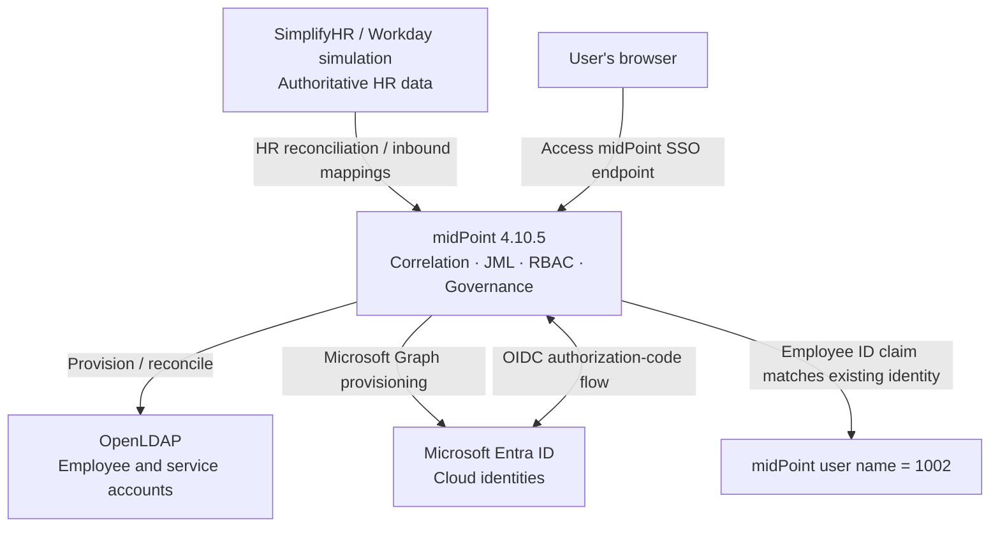

### Technologies

| Layer | Implementation |
|---|---|
| HR system (simulated) | SimplifyHR, representing Workday HCM |
| Identity governance | Evolveum midPoint **4.10.5** |
| Cloud directory and IdP | Microsoft Entra ID |
| Cloud provisioning | Microsoft Graph connector/resource |
| LDAP directory | OpenLDAP, viewed via phpLDAPadmin |
| Deployment | Docker Desktop / Docker Compose on Windows |
| Automation and diagnosis | Reconciliation tasks, PowerShell / Microsoft Graph SDK, Docker logs |
| SSO protocol | OIDC authorization-code flow, Entra claims mapping policy |

## 2. Implemented capabilities

| Capability | Evidence / outcome | Status |
|---|---|---|
| HR authoritative identity feed | SimplifyHR records imported into midPoint and reconciled | Demonstrated |
| Joiner | HR identity creation, Employee role assignment, target provisioning | Demonstrated |
| Mover | Department and cost-center changes reflected in midPoint and targets | Demonstrated |
| Leaver | HR termination, disabled identity, Entra soft deletion, LDAP inactive OU | Demonstrated |
| RBAC | Employee, Engineering Employee, HR Employee, End user roles | Demonstrated |
| Multi-target provisioning | OpenLDAP and Entra ID accounts managed from midPoint | Demonstrated; see LDAP caveat |
| Non-human identity governance | OpenLDAP `svc-backup` linked to HR identity `1002` by employee-number correlation | Demonstrated in earlier lab |
| OIDC SSO | Entra login reaches midPoint as existing identity `1002` | Demonstrated |
| Custom claims | Entra `employeeid` token claim mapped to midPoint user `name` | Demonstrated |
| Protected downstream app SSO | Separate application protected by Entra | Not implemented in this project |

## 3. Local lab topology

| Service | Lab URL / detail |
|---|---|
| midPoint | `http://localhost:8080/midpoint` |
| SimplifyHR | `http://localhost:8085` |
| phpLDAPadmin | `http://localhost:8089` |
| Compose project | `C:\IAM\simplifyiam-lab` |
| midPoint container | `simplifyiam-lab-midpoint-1` |
| LDAP container | `simplifyiam-lab-ldap-1` |

The values above are **local lab examples**; they are not externally reachable public endpoints. Do not publish real secrets or `.env` files.

## 4. HR-driven identity lifecycle (JML)

### 4.1 Joiner — authoritative HR to target accounts

1. A worker is created or activated in SimplifyHR.
2. midPoint's HR resource reconciliation imports or updates the focus identity, using the HR employee ID as the identity name.
3. Inbound mappings populate name, full name, email, department, employee number and cost center.
4. Object templates and role autoassignment determine access (for example, Employee plus a department-specific business role).
5. midPoint provisions target accounts to OpenLDAP and, for the configured scope, Entra ID through Microsoft Graph.
6. Validate the person, assignments, projections, and target directory attributes.

**Example:** James Anderson, employee ID `1002`, is represented in midPoint as `name=1002`; his Entra account uses an email-shaped UPN in the tenant's `onmicrosoft.com` domain. **Identity** and **directory account** are deliberately different objects.

**Verified Joiner evidence — Jamila Bah (employee ID `1008`):**

A new active Sales employee was created in SimplifyHR and ingested by midPoint. After troubleshooting the initial Entra password-validation error, the completed test shows the identity in midPoint with a populated full name and an enabled account in Microsoft Entra ID. The Entra account displays **Department: Sales** and **Employee ID: 1008**, matching the HR source. The screenshots verify the final state, not the detailed remediation of the earlier error.

| Evidence | Verification |
|---|---|
| 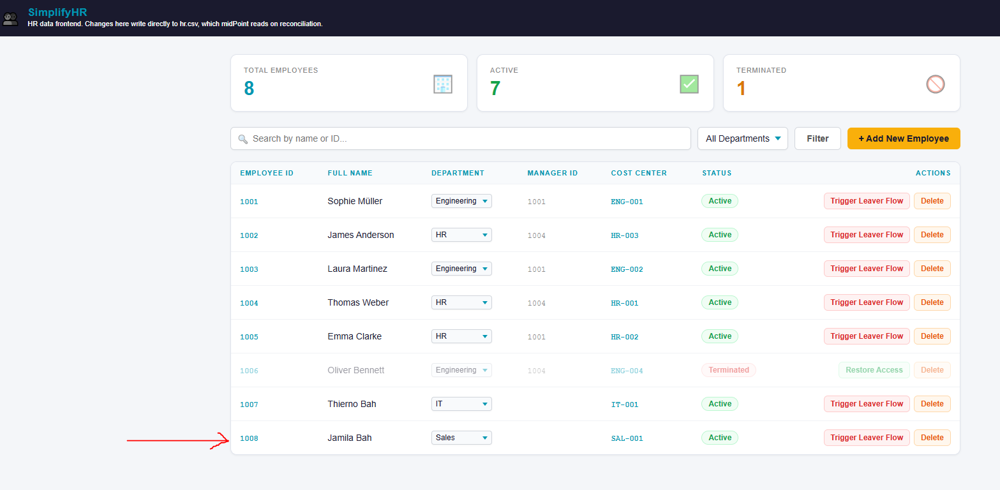 | Authoritative HR record: Jamila Bah, employee `1008`, Sales, cost center `SAL-001`, Active. |
| 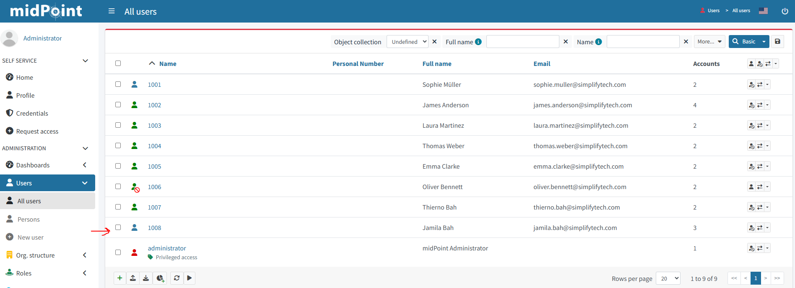 | midPoint user `1008` has Full Name **Jamila Bah**, HR email and **3 accounts** displayed. |
| 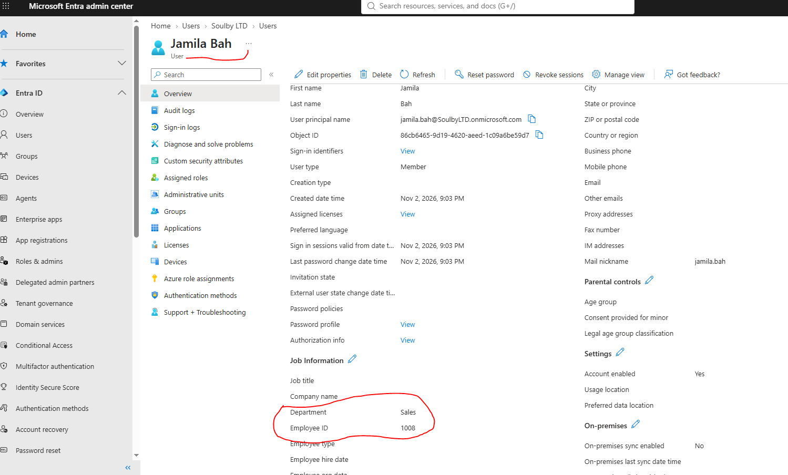 | Entra ID account `jamila.bah@SoulbyLTD.onmicrosoft.com` is enabled, with Department **Sales** and Employee ID **1008**. |

**Scope of proof:** These captures demonstrate the new HR identity and its provisioned Entra directory account with matching attributes. They do **not** independently prove all three midPoint projections are healthy, LDAP joiner provisioning, or the precise password-error remediation. See [Joiner evidence notes](docs/joiner-evidence.md) for a compact verification record.

### 4.2 Mover — department-driven access change

The lab tested a department transition for James Anderson from **IT to HR**, including cost center **`IT-002` → `HR-003`**. After the HR change and reconciliation, midPoint showed **Organizational Unit: HR**, **Cost Center: HR-003**, and **HR Employee** assignment. Target verification included LDAP department/cost-center attributes and Entra department metadata.

The project also tested department-specific role rules, including an Engineering Employee role. Department transitions should be validated for **both new access assignment and obsolete access removal**; don't infer successful revocation solely from a role being visible.

**Mover evidence — James Anderson (employee 1002):**

| Evidence | Verification |
|---|---|
| 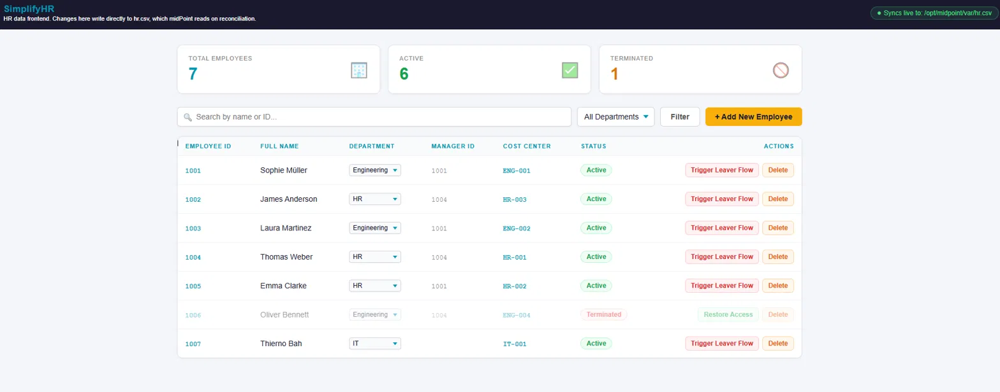 | SimplifyHR HR feed shows employee 1002 in HR with cost center `HR-003`. |
| 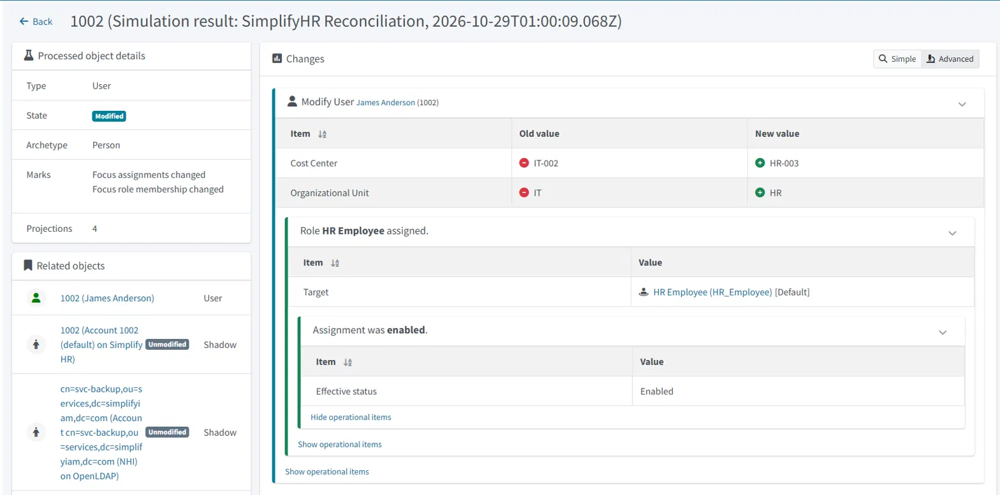 | Reconciliation simulation records `IT-002 → HR-003`, `IT → HR`, and assignment of the **HR Employee** role. |
| 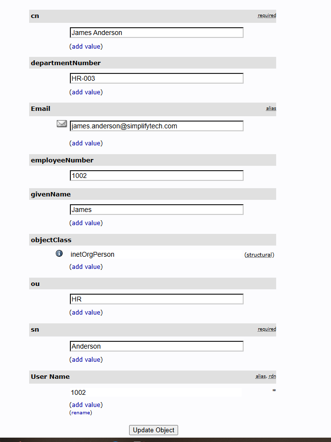 | LDAP entry shows `ou=HR`, `departmentNumber=HR-003`, and `employeeNumber=1002`. |
| 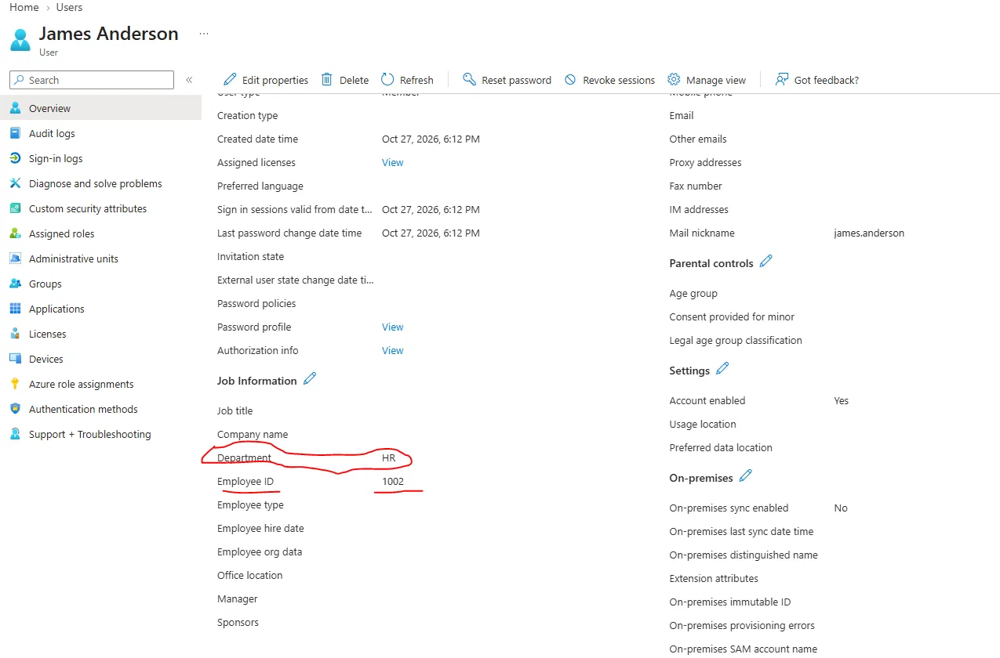 | Entra ID user record shows Department `HR`, Employee ID `1002`, and enabled account. |
| 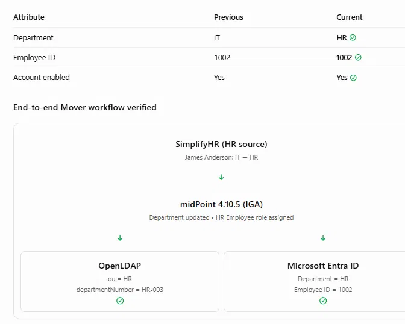 | End-to-end comparison summarizes the HR source, midPoint role assignment, and both target directory checks. |

These captures verify the **mover update and new role assignment**, but do not independently prove removal of every previous IT entitlement.

### 4.3 Leaver — disable and deprovision

The leaver scenario used a terminated James Anderson HR record and demonstrated:

- HR termination state in SimplifyHR.
- Disabled identity in midPoint.
- Entra ID account soft-deleted (recoverable deleted-user state).
- LDAP account moved to the inactive OU, with additional checks around password/bind behavior.

**Leaver evidence:**

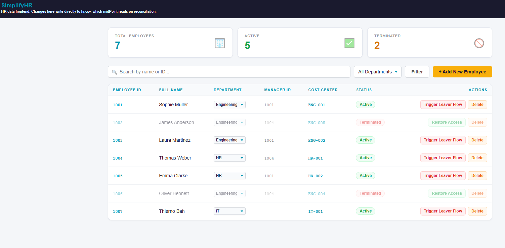
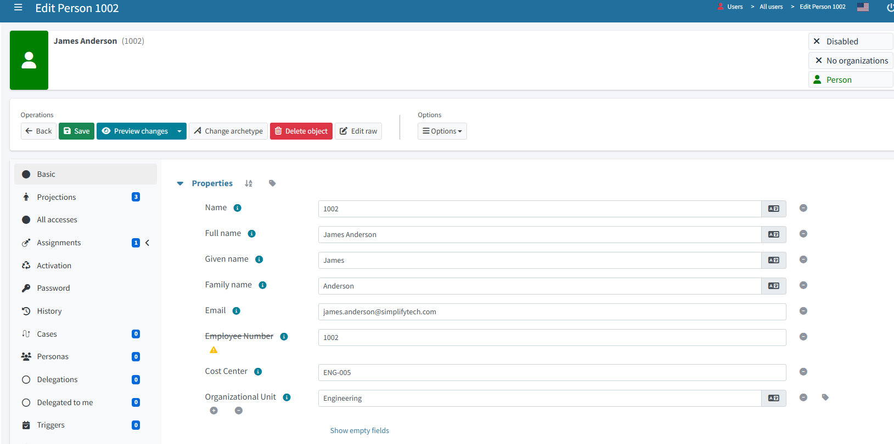
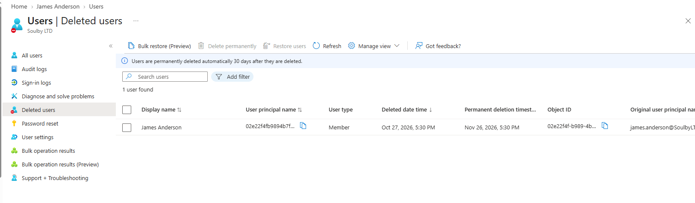
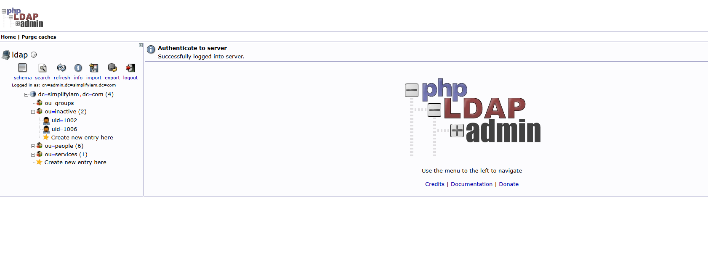

> During subsequent testing, James was restored to active status and reprovisioned. The leaver screenshots show a **specific test execution**, not the final state of every account.

## 5. RBAC and identity correlation

midPoint uses the HR employee ID as a stable identity key. Role assignment is driven by HR attributes and object templates:

| Role / archetype | Purpose |
|---|---|
| Person archetype | Marks HR-managed person objects |
| Employee | Baseline employee entitlement |
| Engineering Employee | Department-specific access for Engineering |
| HR Employee | Department-specific access for HR |
| End user | Allows access to the midPoint self-service interface |

The role-assignment screenshot below confirms that James (`1002`) has **Employee**, **HR Employee**, and **End user** at the time of the SSO test.

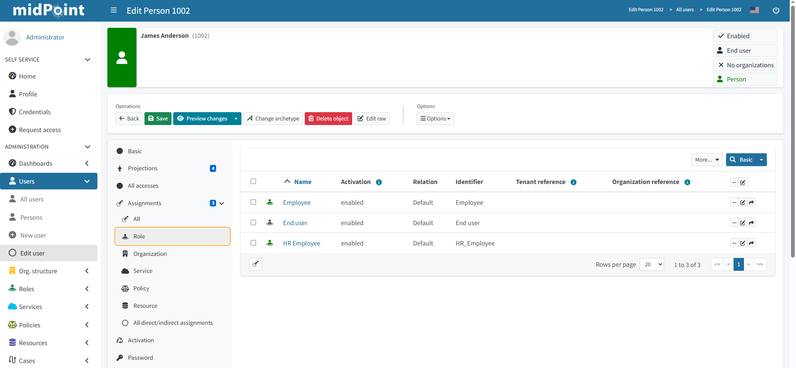

### Non-human identities (NHI)

A separate OpenLDAP `NHI` intent was configured under `ou=services`. The `svc-backup` account carries an owner reference in LDAP's `carLicense` attribute (`1002`), allowing midPoint to correlate it with the HR person named `1002`. The lab used an NHI-scoped reconciliation and link/synchronize reactions to associate the service account with its owner. This is **ownership correlation**, not a claim that the service account is a human identity.

## 6. Entra ID provisioning via Microsoft Graph

The cloud provisioning resource uses a separate Entra app registration for Microsoft Graph operations. Mappings exercised in the lab included:

- `displayName` from midPoint full name.
- `userPrincipalName` built with the lab's `onmicrosoft.com` domain.
- `accountEnabled` based on lifecycle / administrative status.
- Department and employee ID attributes for cloud directory alignment.
- Reconciliation, including preview and production modes, to inspect planned and applied changes.

The **Graph provisioning application** and the **OIDC SSO application** are distinct registrations with different purposes and permissions.

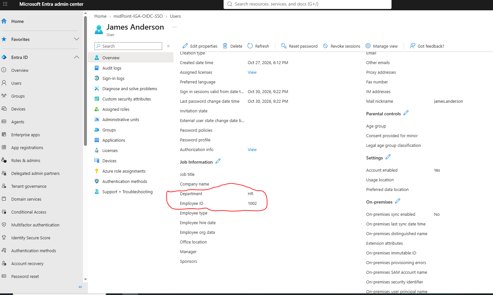

## 7. Entra ID OIDC SSO into midPoint — final milestone

The OIDC work adds federated sign-in **to midPoint itself**. It does not replace the HR source or the existing provisioning connector.

### 7.1 Entra application and claims

The single-tenant Entra application `midPoint-IGA-OIDC-SSO` was configured with a Web redirect URI and client secret. The standard optional ID-token claim picker did not offer `employeeId`, so the lab used a **claims mapping policy** on the application's service principal and enabled `acceptMappedClaims` in the app manifest.

The final token claim is named **`employeeid`** and is sourced from the Entra user Employee ID attribute. For James, its value is **`1002`**.

### 7.2 midPoint authentication policy

The **Default Security Policy** retains the existing local login form and HTTP Basic sequences. A separate OIDC module and `entra-sso` sequence were added:

| Setting | Value |
|---|---|
| OIDC module identifier | `entra-oidc` |
| OIDC registration ID | `entra` |
| Sequence identifier | `entra-sso` |
| Sequence URL suffix | `entra` |
| SSO start URL | `http://localhost:8080/midpoint/auth/entra` |
| **Actual midPoint callback** | `http://localhost:8080/midpoint/auth/entra/entra-oidc/authenticate/entra` |
| Matching token claim | `employeeid` |
| Matching midPoint username | `1002` |

**Important:** The callback above was confirmed from the actual OIDC authorization request. It is **not** the generic Spring Security example `/login/oauth2/code/entra` suggested during early investigation.

### 7.3 Identity matching — no duplicate HR user

The Entra UPN and midPoint identity name are intentionally different:

```text
Entra UPN:      james.anderson@<tenant>.onmicrosoft.com
Entra employeeId: 1002
OIDC claim:     employeeid = "1002"
midPoint name:  1002
Result:         Entra authentication → existing HR-managed midPoint user 1002
```

An initial temporary midPoint user named after the Entra UPN was used to prove the OIDC flow. The **final** test instead signed in as **`1002`**, avoiding the duplicate identity as the intended operating model.

### 7.4 Verified sign-in

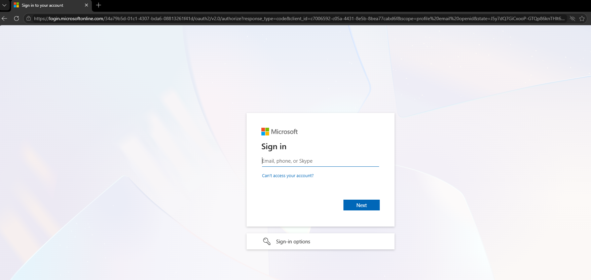
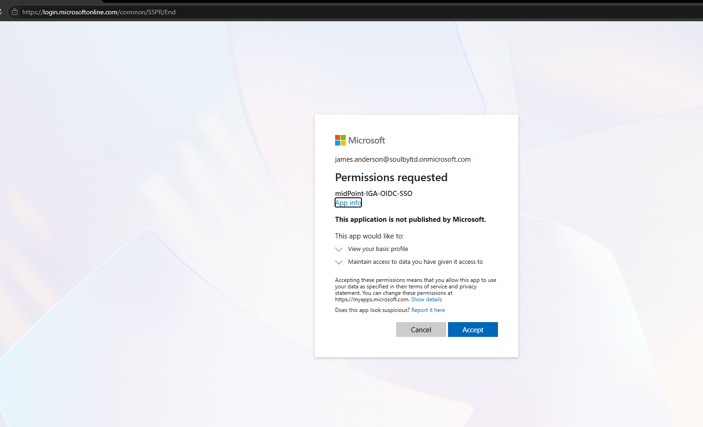
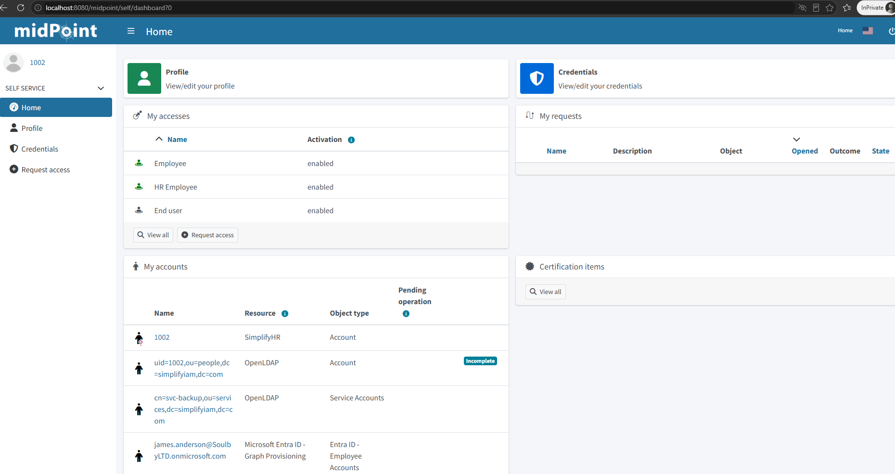

The final screenshot shows a midPoint self-service session for user `1002`, with **Employee**, **HR Employee**, and **End user** access and the person's HR, LDAP, service-account, and Entra projections. The LDAP projection is marked **Incomplete**; SSO success should not be interpreted as proof that every target projection is healthy.

**Full technical walkthrough:** [OIDC implementation, Graph commands, Docker fixes, troubleshooting and rollback](docs/oidc-implementation.md).

## 8. Troubleshooting and lessons learned

| Issue encountered | Diagnostic finding | Outcome / lesson |
|---|---|---|
| Redirect loop (`ERR_TOO_MANY_REDIRECTS`) | OIDC client configuration / session problems | Verified the module configuration and used a fresh browser session |
| `web.security.provider.unavailable` | Generic OIDC provider error | Read DEBUG logs rather than relying on UI message |
| Java `Network is unreachable` | IPv6 connectivity issue during outbound token request | Set `-Djava.net.preferIPv4Stack=true` for the lab container |
| Java `trustAnchors ... must be non-empty` | Java TLS trust-store problem | Pointed Java to the container's trust store |
| Entra claims picker lacks employee ID | Standard optional claim unavailable | Created and assigned an Entra claims mapping policy |
| Graph `AADSTS70011` | Invalid scopes/authority during authentication | Corrected tenant-specific Graph connection |
| Graph 403 on policy listing | Missing required Graph delegated scope | Reconnected with `Policy.Read.All` |
| LDAP `inetOrgPerson` requires `sn` | Temporary user lacked surname | Populate required LDAP attributes |
| OpenLDAP projection `Incomplete` | Shown on final user dashboard | **Still requires investigation**; not presented as fixed |

Example JVM options used for the **lab environment**:

```yaml
# midPoint service environment; validate paths in your own image
_JAVA_OPTIONS: "-Djava.net.preferIPv4Stack=true -Djavax.net.ssl.trustStore=/etc/ssl/certs/java/cacerts -Djavax.net.ssl.trustStorePassword=changeit"
```

These options are environment-specific workarounds, **not** general production recommendations. `changeit` is the conventional Java trust-store password, not an Entra application secret.

## 9. Evidence index

This repository includes evidence captured during implementation, including both successes and failures. The filenames correspond to the lab's recorded screenshots.

**OIDC / Graph / troubleshooting:** `images/oidc/01-...png` through `21-...png`. Key milestones:

| Evidence | File |
|---|---|
| Redirect URI configuration | [01](images/oidc/01-entra-add-redirect-uri.png) |
| Optional claim limitation | [02](images/oidc/02-entra-optional-claims-list.png) |
| Manifest `acceptMappedClaims` | [03](images/oidc/03-entra-manifest-acceptmappedclaims.png) |
| Claims policy assigned | [06](images/oidc/06-claims-policy-assigned.png) |
| Java options loaded | [08](images/oidc/08-java-options-picked-up.png) |
| midPoint security policy | [09](images/oidc/09-midpoint-security-policy-edit-raw.png) |
| HR identity role assignments | [11](images/oidc/11-midpoint-user-1002-roles.png) |
| Temporary-user SSO success | [15](images/oidc/15-sso-success-temp-user.png) |
| **Final HR identity SSO success** | **[16](images/oidc/16-sso-success-user-1002.png)** |
| Provider error audit event | [17](images/oidc/17-audit-log-provider-unavailable.png) |
| Browser redirect error | [18](images/oidc/18-too-many-redirects.png) |
| Graph scope error | [19](images/oidc/19-graph-aadsts70011-scope-error.png) |
| Graph 403 | [20](images/oidc/20-graph-403-forbidden.png) |
| Token exchange network error | [21](images/oidc/21-debug-log-network-unreachable.png) |

**Leaver:** `images/leaver/02-...png` through `14-...png`, documenting pre-termination projections, HR termination, disabled state, Entra soft deletion, LDAP inactive OU, and LDAP bind checks.

**Mover evidence:** Five verified screenshots are included in `images/mover/`.

**Joiner evidence:** Three verified screenshots are included in `images/joiner/`, showing HR creation, midPoint identity creation, and the provisioned Entra account for employee `1008`.

## 10. Known limitations and next steps

- [ ] Investigate the **Incomplete** OpenLDAP projection for user `1002` and reconcile it without creating duplicate accounts.
- [ ] Remove the temporary UPN-named midPoint SSO test user **after** confirming it is no longer needed; assess downstream account cleanup first.
- [ ] Disable temporary DEBUG logging.
- [ ] Confirm least-privilege Graph permissions and remove elevated administration privileges when no longer needed.
- [ ] Rotate any OIDC client secret that may have been exposed during testing; store secrets outside source control.
- [ ] Replace lab-only `localhost` endpoints and local HTTP with an appropriate HTTPS deployment for any non-lab use.
- [ ] Add an independently protected application using Entra ID SSO as a future extension.
- [x] Add verified HR → midPoint → Entra ID Joiner evidence for employee `1008`.
- [ ] Verify the new Joiner’s LDAP projection and all account health statuses, verify obsolete entitlement removal during Mover testing, and implement automated regression tests.

**Joiner screenshot redaction checklist (before public release):** Review `images/joiner/` for full names, employee IDs, UPNs, tenant domain, Entra object ID, and other employees visible in the HR and midPoint lists. Redact or crop as appropriate; keep identifiers consistent across evidence.

**Mover screenshot redaction checklist (before public release):** Review all five `images/mover/` files for full names, email addresses, employee IDs, and internal HR records; mask any real or personally identifying details. The SimplifyHR screenshot also shows multiple employee records; crop or redact unrelated rows. Use consistent synthetic identifiers where possible.

## 11. Security and publishing guidance

**Before pushing this evidence folder to a public GitHub repository, review and redact every screenshot.** Some captures contain tenant identifiers, UPNs, administrator information, authentication request parameters, or encrypted secret metadata. See the detailed [redaction checklist](docs/oidc-implementation.md#screenshot-redaction-checklist). **Do not publish client secrets, tokens, `.env` files, real credentials, or unsanitized authentication logs.** An encrypted value displayed in a screenshot should still be treated as sensitive implementation evidence.

Suggested `.gitignore`:

```gitignore
.env
.env.*
!.env.example
*.secret
*credentials*
*.pfx
*.pem
*.key
oidc.txt
logs/
```

## 12. What this project demonstrates

- **IAM / IGA engineering:** authoritative HR integration, identity correlation, provisioning, reconciliation, and lifecycle automation.
- **Governance:** role-based access, mover-driven entitlement changes, leaver controls, and service-account ownership.
- **Cloud identity:** Entra ID / Microsoft Graph integration and custom token claims.
- **Federation:** practical OIDC authentication, redirect URI verification, and matching external IdP claims to existing internal identities.
- **Troubleshooting:** Java/Docker networking, TLS trust stores, Graph authorization errors, LDAP schema requirements, and SSO debugging.

---

**Documentation:** [Detailed OIDC lab runbook](docs/oidc-implementation.md) · **Evidence:** [`images/oidc`](images/oidc) and [`images/leaver`](images/leaver)

*Built as a personal, hands-on IAM portfolio lab. Product names belong to their respective owners.*
