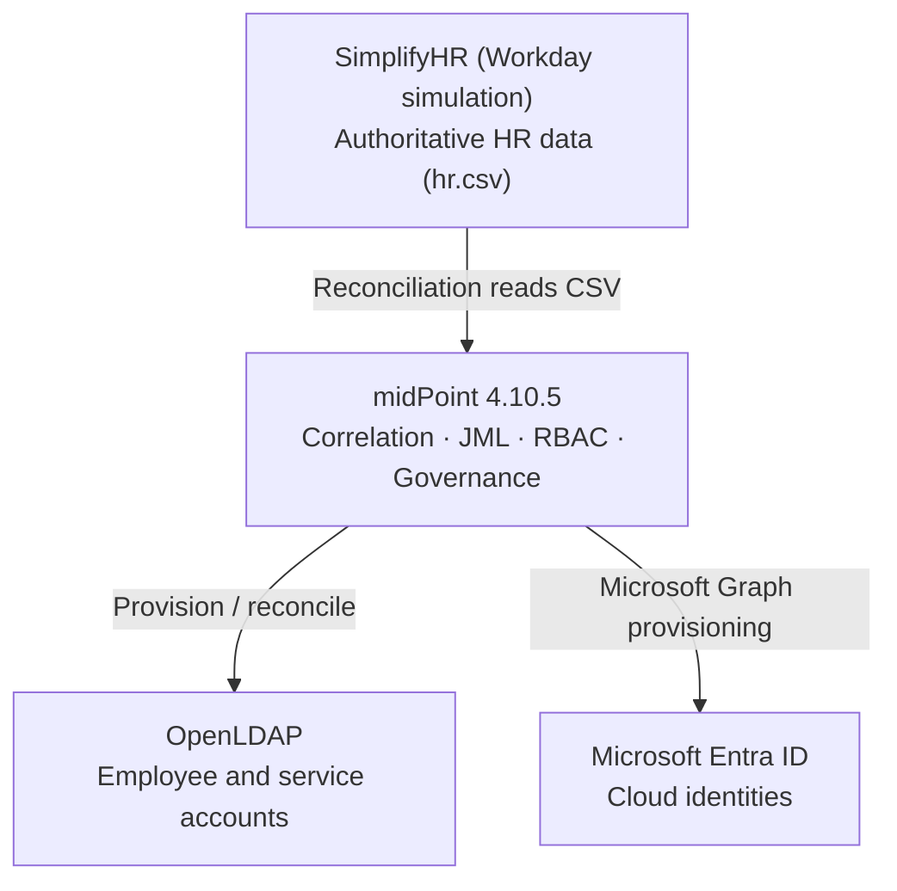
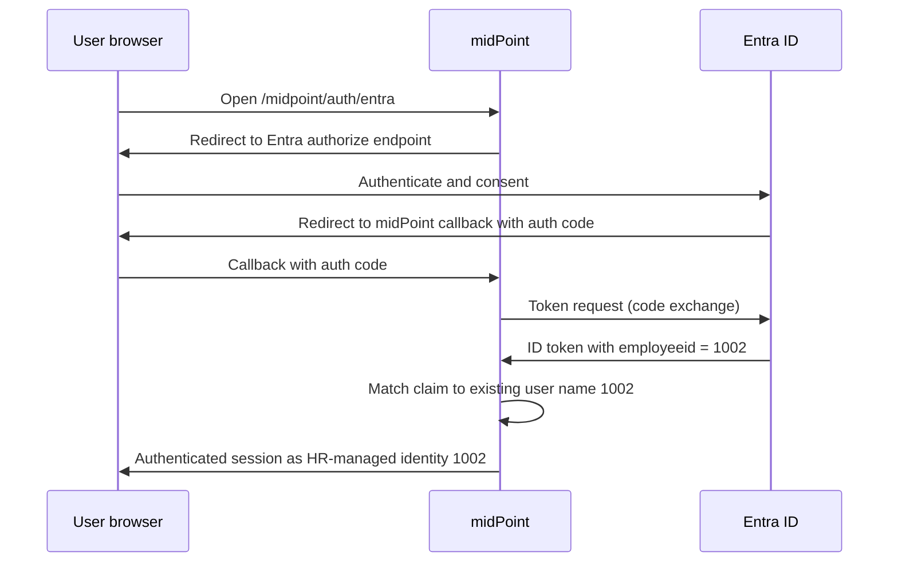

# HR-Driven Identity Lifecycle Management
### SimplifyHR (Workday simulation) → midPoint → Microsoft Entra ID & OpenLDAP

A hands-on **Identity Governance & Administration (IGA)** portfolio lab. It demonstrates HR-authoritative Joiner–Mover–Leaver (JML) automation, role-based access control (RBAC), multi-target provisioning, non-human identity (NHI) ownership, and Microsoft Entra ID **OpenID Connect (OIDC) single sign-on** into midPoint.

> **Status:** Joiner, Mover, Leaver and Entra OIDC SSO are demonstrated end to end with screenshot evidence. Known gaps (mover revocation proof, untested lifecycle scenarios, clean-up items) are listed in [section 11](#11-known-limitations-and-roadmap). This is a lab, not a production deployment.
>
> **Scope:** Workday itself is **not** connected. SimplifyHR emulates the Workday HR feed by writing a CSV file that midPoint reads on reconciliation. SSO to a separate protected application is a future extension, not an implemented outcome.

## At a glance

| | |
|---|---|
| **Authoritative source** | SimplifyHR (`hr.csv`), standing in for Workday HCM |
| **IGA engine** | Evolveum midPoint 4.10.5 |
| **Targets** | Microsoft Entra ID (Microsoft Graph), OpenLDAP |
| **Lifecycle demonstrated** | Joiner (`1008`), Mover (`1002`, IT → HR), Leaver (`1002`) |
| **Federation** | Entra ID OIDC sign-in to midPoint, matched on an `employeeid` claim |
| **Governance** | Role-based access, NHI ownership correlation (`svc-backup` → `1002`) |

## Contents

1. [Executive summary](#1-executive-summary)
2. [Architecture](#2-architecture)
3. [Capability matrix](#3-capability-matrix)
4. [Lab topology and reproduction](#4-lab-topology-and-reproduction)
5. [HR-driven lifecycle (JML)](#5-hr-driven-lifecycle-jml)
6. [RBAC and non-human identities](#6-rbac-and-non-human-identities)
7. [Entra ID provisioning via Microsoft Graph](#7-entra-id-provisioning-via-microsoft-graph)
8. [Entra ID OIDC SSO into midPoint](#8-entra-id-oidc-sso-into-midpoint)
9. [Design and security notes](#9-design-and-security-notes)
10. [Troubleshooting and lessons learned](#10-troubleshooting-and-lessons-learned)
11. [Known limitations and roadmap](#11-known-limitations-and-roadmap)
12. [Evidence index](#12-evidence-index)
13. [Security and publishing guidance](#13-security-and-publishing-guidance)
14. [What this project demonstrates](#14-what-this-project-demonstrates)

---

## 1. Executive summary

**Problem.** In most organizations, joiner, mover and leaver changes reach directories and applications late, inconsistently, or by ticket. Orphaned accounts and stale access follow.

**Approach.** HR is the single source of truth. **SimplifyHR** simulates Workday. **midPoint** ingests HR records, correlates them to identities, assigns business roles from HR attributes, and provisions accounts to **OpenLDAP** and **Microsoft Entra ID**. Entra ID also acts as an external **OIDC identity provider for midPoint**, so an Entra login lands on the *existing* HR-managed identity `1002` rather than a duplicate.

**Key design principle.** An **identity** (the person in midPoint, keyed by HR employee ID) is deliberately a different object from a **directory account** (LDAP entry, Entra user). Accounts are projections of the identity, which is what makes automated disable and clean-up possible.

### Technologies

| Layer | Implementation |
|---|---|
| HR system (simulated) | SimplifyHR, representing Workday HCM |
| Identity governance | Evolveum midPoint **4.10.5** |
| Cloud directory and IdP | Microsoft Entra ID |
| Cloud provisioning | Microsoft Graph connector / resource |
| LDAP directory | OpenLDAP, viewed via phpLDAPadmin |
| Deployment | Docker Desktop / Docker Compose on Windows |
| Diagnosis and automation | Reconciliation tasks, PowerShell with Microsoft Graph SDK, Docker logs |
| SSO | OIDC authorization-code flow with an Entra claims mapping policy |

## 2. Architecture

### 2.1 Provisioning flow



### 2.2 SSO flow (separate from provisioning)



### 2.3 How the lab maps to a production Workday + Entra design

| Lab component | Production equivalent |
|---|---|
| SimplifyHR (writes `hr.csv`; poll-based) | Workday HCM (Integration System User, report-as-a-service or Web Services; Entra inbound provisioning polls on a cycle) |
| midPoint inbound mappings and correlation | Entra inbound provisioning from Workday, or midPoint with a Workday connector |
| midPoint roles / object templates | Birthright roles, dynamic groups, Entra entitlement management / access packages |
| midPoint leaver handling | Entra Lifecycle Workflows (offboarding tasks) and provisioning scoping |
| OpenLDAP | On-premises AD or other LDAP targets |
| NHI ownership correlation | Service principal / managed identity ownership, access reviews |

The lab proves the **patterns** (authoritative source, correlation, role-driven access, automated leaver). Connector and tenant specifics would differ in production.

## 3. Capability matrix

| Capability | Outcome | Status | Evidence |
|---|---|---|---|
| HR authoritative feed | SimplifyHR records imported into midPoint and reconciled | Demonstrated | `images/joiner/`, `images/mover/` |
| Joiner | Identity created, Employee role assigned, Entra account provisioned (`1008`) | Demonstrated | `images/joiner/` |
| Mover | Department and cost center changes propagated to LDAP and Entra (`1002`) | Demonstrated; revocation not yet proven | `images/mover/` |
| Leaver | HR termination → disabled identity, Entra soft delete, LDAP inactive OU | Demonstrated | `images/leaver/` |
| RBAC | Employee, Engineering Employee, HR Employee, End user | Demonstrated | `images/oidc/11` |
| Multi-target provisioning | OpenLDAP and Entra managed from midPoint | Demonstrated; LDAP "Incomplete" label resolved | `images/mover/`, `images/joiner/` |
| NHI governance | `svc-backup` linked to HR identity `1002` by employee-number correlation | Demonstrated in earlier lab | Pending |
| OIDC SSO | Entra login reaches midPoint as `1002` | Demonstrated | `images/oidc/16` |
| Custom token claim | `employeeid` claim mapped to midPoint `name` | Demonstrated | `images/oidc/03, 06, 10` |
| Rehire | James restored to active and reprovisioned during testing | Observed, not formally documented | None |
| Protected downstream app SSO | Separate app protected by Entra | Not implemented | n/a |

## 4. Lab topology and reproduction

| Service | Lab URL / detail |
|---|---|
| midPoint | `http://localhost:8080/midpoint` |
| SimplifyHR | `http://localhost:8085` |
| phpLDAPadmin | `http://localhost:8089` |
| Compose project | `C:\IAM\simplifyiam-lab` |
| midPoint container | `simplifyiam-lab-midpoint-1` |
| LDAP container | `simplifyiam-lab-ldap-1` |

These are **local lab values**, not public endpoints. Never publish real secrets or `.env` files.

**Suggested reproduction order** (adapt to your repository layout):

1. Start the stack: `docker compose up -d` from the Compose project folder; confirm all three web UIs load.
2. Import the HR resource and run HR reconciliation in midPoint; confirm identities such as `1002` appear.
3. Configure the OpenLDAP resource (employee and `NHI` intents) and run reconciliation.
4. Register the **Graph provisioning** app in Entra, configure the Graph resource, run reconciliation in *simulation* mode, then *production* mode.
5. Register the **OIDC SSO** app, apply the claims mapping policy, add the OIDC module and `entra-sso` sequence in midPoint ([section 8](#8-entra-id-oidc-sso-into-midpoint)).
6. Run the JML scenarios in [section 5](#5-hr-driven-lifecycle-jml).

## 5. HR-driven lifecycle (JML)

### 5.1 Joiner

1. A worker is created or activated in SimplifyHR, which writes the change to `hr.csv`.
2. midPoint's HR reconciliation task reads the CSV (a **poll-based** feed, not an event or API feed) and creates or updates the identity, using the HR employee ID as the identity `name`.
3. Inbound mappings populate name, full name, email, department, employee number and cost center.
4. Object templates and role auto-assignment grant access (for example, Employee plus a department role).
5. midPoint provisions accounts to OpenLDAP and, within the configured scope, Entra ID through Microsoft Graph.
6. Validate the identity, assignments, projections and target attributes.

**Example:** James Anderson, employee ID `1002`, is `name=1002` in midPoint. His Entra account has an email-shaped UPN in the tenant's `onmicrosoft.com` domain.

**Joiner evidence: Jamila Bah (employee ID `1008`).** A new active Sales employee was created in SimplifyHR and ingested by midPoint. After troubleshooting an initial Entra password-validation error, the completed test shows the identity in midPoint with a populated full name and an enabled Entra account showing **Department: Sales** and **Employee ID: 1008**, matching the HR source.

| Evidence | Verification |
|---|---|
|  | HR record: Jamila Bah, `1008`, Sales, cost center `SAL-001`, Active. |
|  | midPoint user `1008` with Full Name **Jamila Bah**, HR email and 3 projections. |
|  | Entra account enabled, Department **Sales**, Employee ID **1008**. |

**Scope of proof:** These captures show the new HR identity and its provisioned Entra account with matching attributes. They do not document the detailed password-error remediation. The LDAP account for `1008` was confirmed separately (present in `ou=people`, correct attributes, and the projection no longer flagged after the fix in [section 10](#10-troubleshooting-and-lessons-learned)); add a dated screenshot of that for completeness. See [Joiner evidence notes](docs/joiner-evidence.md).

### 5.2 Mover

The lab moved James Anderson (`1002`) from **IT to HR** with cost center **`IT-002` → `HR-003`**. After the HR change and reconciliation, midPoint showed Organizational Unit **HR**, Cost Center **HR-003** and the **HR Employee** role. LDAP and Entra attributes were verified.

| Evidence | Verification |
|---|---|
|  | HR feed shows `1002` in HR with cost center `HR-003`. |
|  | **Simulation (preview)** result: `IT-002 → HR-003`, `IT → HR`, **HR Employee** role assigned. This is the planned change, not the applied one. |
|  | LDAP entry: `ou=HR`, `departmentNumber=HR-003`, `employeeNumber=1002`. |
|  | Entra user: Department `HR`, Employee ID `1002`, account enabled. |
|  | **Summary graphic** (not a system capture) comparing the checks above. |

**What this proves:** the mover update and the new role assignment. **What it does not prove:** removal of obsolete access. James had no IT-specific role, so only the grant is shown. To prove revocation, move an Engineering employee (for example `1003`) to HR and capture the Engineering role being removed.

### 5.3 Leaver

The leaver test used a terminated James Anderson record and showed:

- HR termination state in SimplifyHR.
- Identity disabled in midPoint.
- Entra account soft-deleted (recoverable deleted-user state).
- LDAP account moved to the inactive OU (`ou=inactive`), with password/bind checks.


> James was later restored to active and reprovisioned. These screenshots capture **one specific test run**, not the final state of every account. The LDAP leaver works by moving the entry to `ou=inactive` through the DN mapping, not by an LDAP activation attribute.

### 5.4 Lifecycle test matrix

| Scenario | Expected result | Status |
|---|---|---|
| New hire | Identity + Employee role + LDAP and Entra accounts | Demonstrated (`1008`) |
| Department change | New role granted, old role removed, attributes updated on all targets | Grant and attribute updates demonstrated; revocation not yet proven |
| Termination | Identity disabled, Entra soft-deleted, LDAP moved to inactive OU | Demonstrated |
| Rehire | Same identity re-activated, no duplicate accounts | Observed, to be documented |
| Future-dated hire | No access before start date | Not tested |
| Name change | Display name, email and UPN policy applied without breaking correlation | Not tested |
| Manager change | Manager reference updated on targets | Not tested |
| Contractor / non-employee | Separate archetype, end date enforced | Not tested |
| Duplicate employee ID in HR | Correlation conflict surfaced, no silent merge | Not tested |

## 6. RBAC and non-human identities

midPoint uses the HR employee ID as a stable key, and roles are driven by HR attributes through object templates.

| Role / archetype | Purpose |
|---|---|
| Person archetype | Marks HR-managed person objects |
| Employee | Baseline entitlement |
| Engineering Employee | Engineering-specific access |
| HR Employee | HR-specific access |
| End user | Access to midPoint self-service |

At the time of the SSO test, `1002` held **Employee**, **HR Employee** and **End user**:


### Non-human identities

A separate OpenLDAP `NHI` intent under `ou=services` holds service accounts. The `svc-backup` account stores its owner reference (`1002`) in the LDAP `carLicense` attribute, so midPoint can correlate it to the HR person `1002`. An NHI-scoped reconciliation with link/synchronize reactions associates the account with its owner.

This is **ownership correlation**. The service account is not treated as a human identity. Ownership answers "who is accountable for this account, and what happens when they leave?"

### OpenLDAP design decision: attribute directory, no passwords

Employee accounts in OpenLDAP are provisioned for **attributes** (`ou`, `departmentNumber`, `employeeNumber`, `mail`) and carry **no `userPassword`**. Authentication is delegated to Entra ID. The employee account type sets the shadow `purpose` to `regular` with a strong outbound mapping, so midPoint does not treat these accounts as uninitialized. If LDAP login were ever required, the resource would need an outbound password mapping, and the design would have to decide whether midPoint should also own the Entra password (a password-change preview showed it currently does).

## 7. Entra ID provisioning via Microsoft Graph

Provisioning uses a **dedicated Entra app registration** for Graph operations. Mappings exercised:

- `displayName` from the midPoint full name.
- `userPrincipalName` built from the lab's `onmicrosoft.com` domain.
- `accountEnabled` from lifecycle / administrative status.
- Department and employee ID for cloud directory alignment.
- Reconciliation in **simulation** and **production** modes to inspect planned versus applied changes.

The **Graph provisioning app** and the **OIDC SSO app** are separate registrations with different purposes and permissions.

## 8. Entra ID OIDC SSO into midPoint

This adds federated sign-in **to midPoint itself**. It does not replace the HR source or the Graph connector.

### 8.1 Entra application and claims

The single-tenant app `midPoint-IGA-OIDC-SSO` uses a Web redirect URI and a client secret. The optional-claims picker did not offer `employeeId`, so the lab used a **claims mapping policy** on the service principal and enabled `acceptMappedClaims` in the app manifest. The resulting claim is **`employeeid`**, sourced from the Entra Employee ID attribute (`1002` for James).


### 8.2 midPoint authentication policy

The Default Security Policy keeps the existing login form and HTTP Basic sequences. A new OIDC module and sequence were added alongside:

| Setting | Value |
|---|---|
| OIDC module identifier | `entra-oidc` |
| OIDC registration ID | `entra` |
| Sequence identifier | `entra-sso` |
| Sequence URL suffix | `entra` |
| SSO start URL | `http://localhost:8080/midpoint/auth/entra` |
| **Actual midPoint callback** | `http://localhost:8080/midpoint/auth/entra/entra-oidc/authenticate/entra` |
| Matching token claim | `employeeid` |
| Matching midPoint username | `1002` |

> The callback above was confirmed from the real authorization request. It is **not** the generic Spring example `/login/oauth2/code/entra` suggested early in the investigation.

### 8.3 Identity matching without a duplicate user

```text
Entra UPN:         james.anderson@<tenant>.onmicrosoft.com
Entra employeeId:  1002
OIDC claim:        employeeid = "1002"
midPoint name:     1002
Result:            Entra authentication → existing HR-managed midPoint user 1002
```

A temporary midPoint user named after the Entra UPN was used first to prove the OIDC flow. The **final** test signed in as `1002`, which is the intended operating model.

### 8.4 Verified sign-in


The final screenshot shows a self-service session for `1002` with Employee, HR Employee and End user access, plus HR, LDAP, service-account and Entra projections. At the time of this capture the LDAP projection was marked **Incomplete**. That label was later traced to the shadow purpose flag and resolved ([section 10](#10-troubleshooting-and-lessons-learned)), so this screenshot predates the fix. SSO success is not, by itself, proof that every projection is healthy.

Full walkthrough: [OIDC implementation, Graph commands, Docker fixes, troubleshooting and rollback](docs/oidc-implementation.md).

## 9. Design and security notes

These are the points I would raise in a design review of this lab, and the natural bridge from lab to production.

**Claim-based identity matching**
- Matching `employeeid` to the midPoint `name` is simple and works for the lab, but it is only as trustworthy as that attribute. Confirm users cannot edit their own Employee ID and that only the authoritative process writes it.
- Reserve or exclude privileged local names (for example `administrator`) so a crafted employee ID can never collide with them.
- Consider also storing the immutable Entra object ID (`oid`) on the midPoint user and matching on it, or requiring both. Employee IDs can be reassigned or corrected, object IDs cannot.
- Keep the app **single-tenant** and validate issuer and tenant ID.

**Leaver design**
- The lab shows disable plus Entra soft delete in one run. In production, a **staged** leaver is more common: disable and revoke sessions and refresh tokens at once, then delete after a retention period. Entra soft-deleted users can be restored for a limited window (30 days by default).
- Add a **deletion threshold** on reconciliation so a bad HR feed cannot disable or delete many accounts at once.

**Least privilege and secrets**
- Give the Graph provisioning app only the Graph application permissions it needs, and review them. The OIDC app needs only sign-in scopes (`openid`, `profile`, `email`).
- Prefer **certificate credentials** over client secrets for the Graph app outside a lab, and keep secrets in a secrets store rather than `.env` or YAML.
- Remove any elevated admin roles granted for troubleshooting.

**Transport and runtime**
- Replace `localhost` HTTP with HTTPS and a stable hostname. This also forces the redirect URI to be re-registered in Entra.
- Disable DEBUG logging after troubleshooting; DEBUG output can contain tokens and personal data.

## 10. Troubleshooting and lessons learned

| Issue | Diagnostic finding | Outcome / lesson |
|---|---|---|
| `ERR_TOO_MANY_REDIRECTS` | OIDC client configuration / session problem | Verified module config; used a fresh browser session |
| `web.security.provider.unavailable` | Generic OIDC provider error | Read DEBUG logs instead of trusting the UI message |
| Java `Network is unreachable` | IPv6 issue on outbound token request | `-Djava.net.preferIPv4Stack=true` |
| Java `trustAnchors ... must be non-empty` | JVM trust-store problem | Pointed Java at the container's trust store |
| Claims picker lacks employee ID | Standard optional claim unavailable | Claims mapping policy + `acceptMappedClaims` |
| Graph `AADSTS70011` | Invalid scope / authority | Corrected tenant-specific Graph connection |
| Graph 403 on policy listing | Missing delegated scope | Reconnected with `Policy.Read.All` |
| LDAP `inetOrgPerson` requires `sn` | Temporary user lacked surname | Populate required LDAP attributes |
| Entra password-validation error on new joiner (`1008`) | Entra rejected the initial password | Resolved during the joiner test; detailed remediation not captured |
| OpenLDAP projection **Incomplete** | A shadow `purpose` flag, not a provisioning error. LDAP attributes were correct; `ldapsearch` showed no `userPassword` on any employee entry, and a user preview showed no LDAP password mapping | Accounts are attribute-only by design. Added a `lifecycle/purpose` outbound mapping returning `regular` to the employee type. At default (normal) strength it did not change existing shadows; **strong** strength plus a user recompute cleared the label. Verified on `1008` and `1002` |
| Password preview side effect | Previewing a password change on `1008` showed the Entra shadow being modified, not LDAP | Did not save. Shows midPoint owns Entra passwords for HR users |

Lab-only JVM options:

```yaml
# midPoint service environment; validate paths in your own image
_JAVA_OPTIONS: "-Djava.net.preferIPv4Stack=true -Djavax.net.ssl.trustStore=/etc/ssl/certs/java/cacerts -Djavax.net.ssl.trustStorePassword=changeit"
```

These are environment-specific workarounds, not production recommendations. `changeit` is the conventional Java trust-store password, not an Entra secret.

## 11. Known limitations and roadmap

**Resolved**
- [x] OpenLDAP **Incomplete** label: caused by shadow purpose on password-less accounts; fixed with a strong `lifecycle/purpose` mapping and recompute ([section 10](#10-troubleshooting-and-lessons-learned)).
- [x] Verified Joiner evidence (HR → midPoint → Entra) for employee `1008`.
- [x] Verified Mover evidence (HR → midPoint → LDAP and Entra) for employee `1002`.

**Fix now**
- [ ] Run a recomputation task (simulation first) for all Person users so every employee LDAP shadow is updated, and confirm a new test hire never shows Incomplete.
- [ ] Stop provisioning `uid=administrator` to OpenLDAP: exclude the midPoint administrator from the Employee role.
- [ ] Change the OpenLDAP employee type reaction `unmatched → addFocus` to no action, so stray directory entries cannot create midPoint users.
- [ ] Investigate the reconciliation error on `1001` (an existing shadow associated with Sophie Müller), and fix test data (`1001` is its own manager, `1007` has none).
- [ ] Rotate any OIDC client secret that may have been exposed during testing.
- [ ] Disable temporary DEBUG logging.
- [ ] Remove the temporary UPN-named SSO test user after checking for downstream accounts.
- [ ] Review Graph permissions and remove elevated admin roles no longer needed.

**Evidence and quality**
- [ ] Re-run the mover test with an Engineering employee (`1003`) and capture proof that the **old** role and access were removed.
- [ ] Add rehire and NHI screenshots with stable filenames, and a dated LDAP screenshot for joiner `1008`.
- [ ] Make End user a birthright via the Employee role or object template; it was assigned to `1002` by hand, so new joiners would not get SSO self-service.
- [ ] Add automated regression tests for the lifecycle matrix in [section 5.4](#54-lifecycle-test-matrix).

**Next capabilities**
- [ ] Cover untested scenarios: future-dated hire, name change, manager change, contractors, duplicate IDs.
- [ ] Add a staged leaver (disable, revoke sessions, delayed delete) and a reconciliation deletion threshold.
- [ ] Add access request and approval, and periodic access certification (midPoint supports both).
- [ ] Add a separation-of-duties rule and an audit/reporting view.
- [ ] Protect a separate application with Entra SSO.
- [ ] Move to HTTPS with a stable hostname and a secrets store.

## 12. Evidence index

Evidence includes both successes and failures.

| Area | Location | Content |
|---|---|---|
| Joiner | `images/joiner/01-03` | HR record, midPoint identity, Entra account for `1008` |
| Mover | `images/mover/01-05` | HR record, simulation result, LDAP and Entra attributes, summary graphic for `1002` |
| Leaver | `images/leaver/02-14` | Pre-termination projections, HR termination, disabled state, Entra soft delete, LDAP inactive OU, bind checks |
| OIDC / Graph / troubleshooting | `images/oidc/01-21` | See key milestones below |

**Key OIDC milestones**

| Evidence | File |
|---|---|
| Redirect URI configuration | [01](images/oidc/01-entra-add-redirect-uri.png) |
| Optional claim limitation | [02](images/oidc/02-entra-optional-claims-list.png) |
| Manifest `acceptMappedClaims` | [03](images/oidc/03-entra-manifest-acceptmappedclaims.png) |
| Claims policy assigned | [06](images/oidc/06-claims-policy-assigned.png) |
| Java options loaded | [08](images/oidc/08-java-options-picked-up.png) |
| midPoint security policy | [09](images/oidc/09-midpoint-security-policy-edit-raw.png) |
| Entra Employee ID | [10](images/oidc/10-entra-employee-id.png) |
| HR identity role assignments | [11](images/oidc/11-midpoint-user-1002-roles.png) |
| Temporary-user SSO success | [15](images/oidc/15-sso-success-temp-user.png) |
| **Final HR identity SSO success** | **[16](images/oidc/16-sso-success-user-1002.png)** |
| Provider error audit event | [17](images/oidc/17-audit-log-provider-unavailable.png) |
| Browser redirect error | [18](images/oidc/18-too-many-redirects.png) |
| Graph scope error | [19](images/oidc/19-graph-aadsts70011-scope-error.png) |
| Graph 403 | [20](images/oidc/20-graph-403-forbidden.png) |
| Token exchange network error | [21](images/oidc/21-debug-log-network-unreachable.png) |

## 13. Security and publishing guidance

**Review and redact every screenshot before pushing to a public repository.** Do not publish client secrets, tokens, `.env` files, real credentials, or unsanitized authentication logs. An encrypted value visible in a screenshot is still sensitive.

**Redaction checklist**

| Folder | Check for |
|---|---|
| `images/joiner/` | Full names, employee IDs, UPNs, tenant domain, Entra object ID, other employees in HR and midPoint lists |
| `images/mover/` | Names, email addresses, employee IDs, unrelated rows in the SimplifyHR list (crop them) |
| `images/leaver/` | Same as above, plus Entra deleted-user details |
| `images/oidc/` | Tenant and app IDs, admin names, authorization request parameters, encrypted secret metadata |

Use consistent synthetic identifiers where possible, and see the [OIDC redaction checklist](docs/oidc-implementation.md#screenshot-redaction-checklist). Also keep exported midPoint XML (user and resource objects) out of the repo: it contains the tenant name and encrypted bind passwords.

Suggested `.gitignore`:

```gitignore
.env
.env.*
!.env.example
*.secret
*credentials*
*.pfx
*.pem
*.key
oidc.txt
logs/
```

## 14. What this project demonstrates

- **IAM / IGA engineering:** authoritative HR integration, correlation, provisioning, reconciliation, lifecycle automation.
- **Governance:** role-based access, mover-driven entitlement change, leaver controls, service-account ownership.
- **Cloud identity:** Entra ID and Microsoft Graph integration, custom token claims.
- **Federation:** OIDC authentication, redirect URI verification, matching external IdP claims to internal identities.
- **Troubleshooting:** Java/Docker networking, TLS trust stores, Graph authorization errors, LDAP schema requirements, midPoint shadow purpose, SSO debugging.

---

**Documentation:** [OIDC lab runbook](docs/oidc-implementation.md) · [Joiner evidence notes](docs/joiner-evidence.md) · **Evidence:** [`images/joiner`](images/joiner) · [`images/mover`](images/mover) · [`images/leaver`](images/leaver) · [`images/oidc`](images/oidc)

*Personal, hands-on IAM portfolio lab. Product names belong to their respective owners.*
