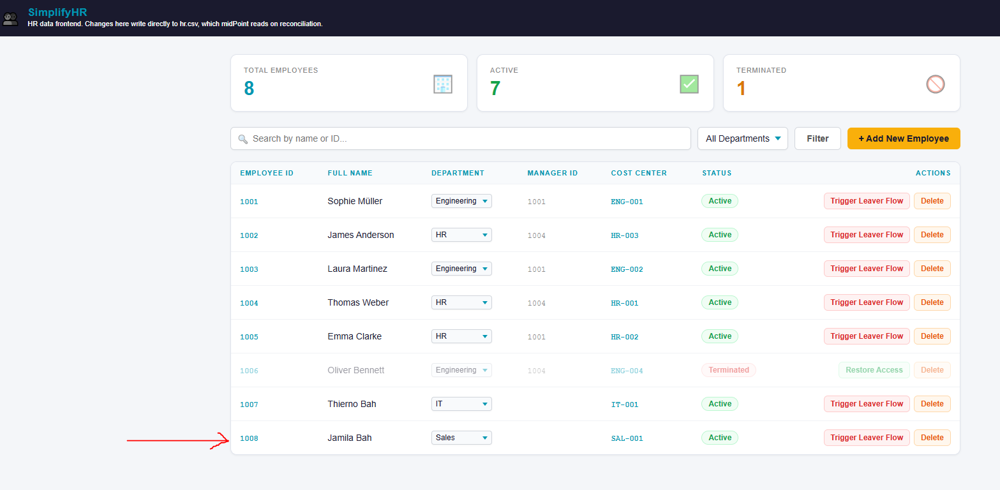
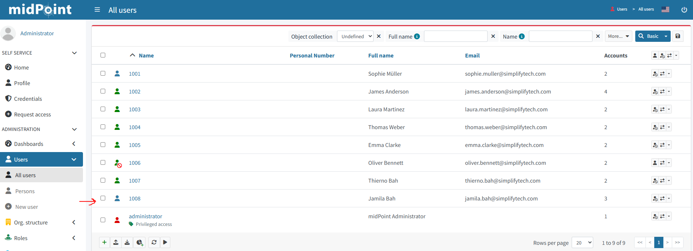
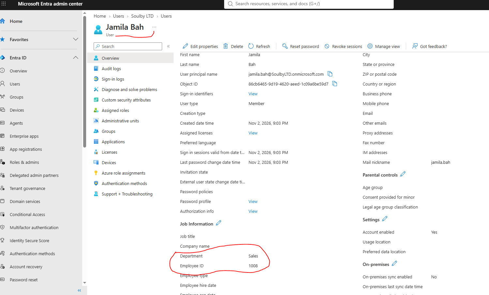

# Joiner evidence — HR to midPoint to Microsoft Entra ID

## Scenario

- **Test identity:** Jamila Bah, HR employee ID `1008` (lab test data).
- **Authoritative source:** SimplifyHR, simulating Workday HCM.
- **Identity governance:** midPoint 4.10.5.
- **Provisioning target verified:** Microsoft Entra ID, via configured Graph provisioning resource.

## Evidence and results

1.   
   HR shows employee `1008` active in Sales with cost center `SAL-001`.
2.   
   midPoint lists identity `1008`, full name **Jamila Bah**, email `jamila.bah@simplifytech.com`, and three accounts.
3.   
   Entra ID displays **Jamila Bah**, UPN `jamila.bah@SoulbyLTD.onmicrosoft.com`, Department **Sales**, Employee ID **1008**, and Account enabled **Yes**.

## Interpretation and boundaries

The three captures together demonstrate that the new HR identity reached midPoint and that the matching Entra directory account was created with the expected department and employee ID. The earlier Entra password-validation error was reported during testing, but these screenshots do not show its specific fix. They also do not independently validate LDAP joiner account health or every midPoint projection.

## Publication safety

Before making the repository public, review these screenshots for employee names, email addresses, tenant domain, Entra object ID, and unrelated personnel records. Redact or crop where appropriate. Never upload credentials, access tokens, or screenshots displaying secrets.
