# midPoint 4.10 + Microsoft Entra ID: OIDC Single Sign-On Lab

This document describes how Microsoft Entra ID (OIDC) single sign-on was added to the SimplifyIAM local lab (midPoint 4.10.5 running in Docker), including every problem hit on the way and how it was fixed.

**Result:** an HR-driven midPoint identity (for example `1002`, James Anderson) signs in to midPoint through Entra ID. Entra sends the employee ID as a custom claim, and midPoint matches it to the user's `name`.

> **Security note.** Every secret, tenant ID and client ID in this document is a placeholder. Never commit real values. Secrets pasted into screenshots or chat should be treated as exposed and rotated.

---

## Table of contents

1. [Architecture](#1-architecture)
2. [Prerequisites](#2-prerequisites)
3. [Entra ID: app registration](#3-entra-id-app-registration)
4. [Docker: Java network and trust store fixes](#4-docker-java-network-and-trust-store-fixes)
5. [midPoint: OIDC module and sequence](#5-midpoint-oidc-module-and-sequence)
6. [Matching Entra users to HR identities](#6-matching-entra-users-to-hr-identities)
7. [Testing](#7-testing)
8. [Troubleshooting log](#8-troubleshooting-log)
9. [Cleanup and hardening](#9-cleanup-and-hardening)
10. [Rollback](#10-rollback)

---

## 1. Architecture

```
Browser ──► midPoint (localhost:8080) ──► Entra ID (login.microsoftonline.com)
              │   /midpoint/auth/entra        │
              │                               │ 1. user signs in
              │◄── authorization code ────────┘
              │
              │ 2. midPoint exchanges code for tokens (server side, HTTPS)
              │ 3. reads the `employeeid` claim (for example "1002")
              ▼
        looks up midPoint user whose name = "1002"
```

| Component | Value |
|---|---|
| midPoint | 4.10.5, `evolveum/midpoint:latest`, Docker Compose |
| Authentication module | `oidc` (identifier `entra-oidc`) |
| Authentication sequence | `entra-sso`, URL suffix `entra` |
| Login URL | `http://localhost:8080/midpoint/auth/entra` |
| Redirect URI | `http://localhost:8080/midpoint/auth/entra/entra-oidc/authenticate/entra` |
| Username claim | `employeeid` (custom, added through a claims mapping policy) |

The redirect URI follows the pattern:

```
http://<host>:8080/midpoint/auth/<sequence urlSuffix>/<module identifier>/authenticate/<registrationId>
```

It is **not** the Spring default `/login/oauth2/code/<registrationId>`. The reliable way to get the exact value is to start a login and read `redirect_uri=` from the Entra URL (it is URL-encoded).

---

## 2. Prerequisites

- The lab stack running (`docker compose up -d`): PostgreSQL, midPoint, OpenLDAP, SimplifyHR.
- An Entra tenant where you hold **Global Administrator** (or equivalent) to create the claims mapping policy.
- A test user in Entra whose **Employee ID** equals the midPoint user name (for example `1002`).
- A midPoint user with that name that holds a role allowing GUI login (for example **End user**).

---

## 3. Entra ID: app registration

1. **App registrations → New registration.** Single tenant. Note the **Application (client) ID** and **Directory (tenant) ID**.
2. **Authentication → Add a platform → Web.** Add the redirect URI from section 1 exactly, with no trailing slash. Entra does not accept wildcards, and `http://` is allowed for `localhost`.
3. **Certificates & secrets → New client secret.** Copy the **Value** immediately. It is shown once. The **Secret ID** is not the secret.
4. **Manifest.** In the `api` section set:

   ```json
   "acceptMappedClaims": true
   ```

   Without this, sign-in fails with `AADSTS50146` once a claims mapping policy is assigned.

### Claims mapping policy (emit `employeeid`)

Employee ID is not available in the portal's optional-claims list, so it is added through a claims mapping policy. Run in Azure Cloud Shell (PowerShell). Connect with the tenant ID and the required scopes. Without `-TenantId` the device-code sign-in can fail with `AADSTS70011`, and without `Policy.Read.All` listing policies returns 403.

```powershell
Connect-MgGraph -TenantId <TENANT-ID> `
  -Scopes "Policy.ReadWrite.ApplicationConfiguration","Policy.Read.All","Application.ReadWrite.All" `
  -UseDeviceAuthentication -NoWelcome

$sp  = Get-MgServicePrincipal -Filter "appId eq '<CLIENT-ID>'"

$def = '{"ClaimsMappingPolicy":{"Version":1,"IncludeBasicClaimSet":"true","ClaimsSchema":[{"Source":"user","ID":"employeeid","JwtClaimType":"employeeid"}]}}'
$p   = New-MgPolicyClaimMappingPolicy -Definition @($def) -DisplayName "midPoint-employeeid"

New-MgServicePrincipalClaimMappingPolicyByRef -ServicePrincipalId $sp.Id `
  -BodyParameter @{ "@odata.id" = "https://graph.microsoft.com/v1.0/policies/claimsMappingPolicies/$($p.Id)" }

# verify
Get-MgServicePrincipalClaimMappingPolicy -ServicePrincipalId $sp.Id | Select-Object DisplayName, Id
```

Notes:

- `New-MgServicePrincipalClaimMappingPolicyByRef` prints nothing on success. Use the verify line.
- `$p.Id` may print nothing right after creation. List policies to confirm and avoid creating duplicates.
- Allow a few minutes for Entra to apply a new policy.


### Screenshots

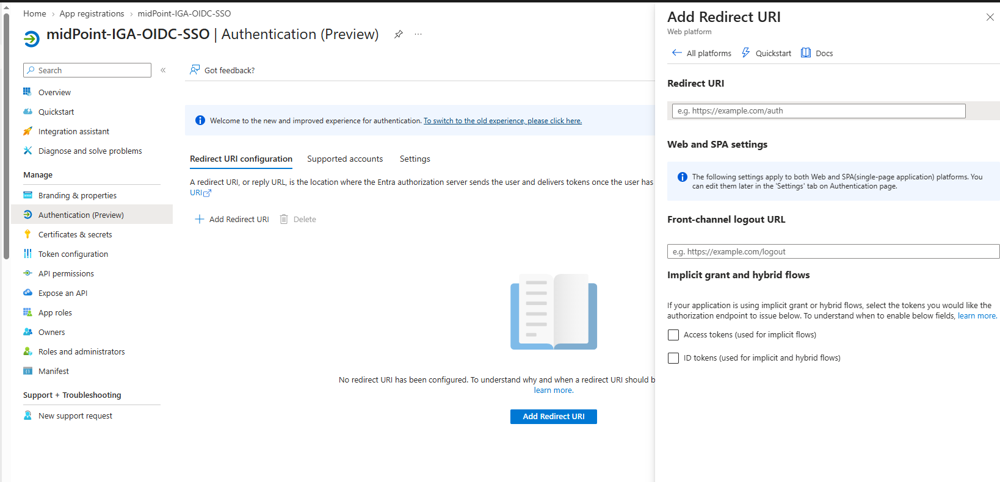
*Entra: the Web redirect URI panel where the midPoint callback URL is registered.*

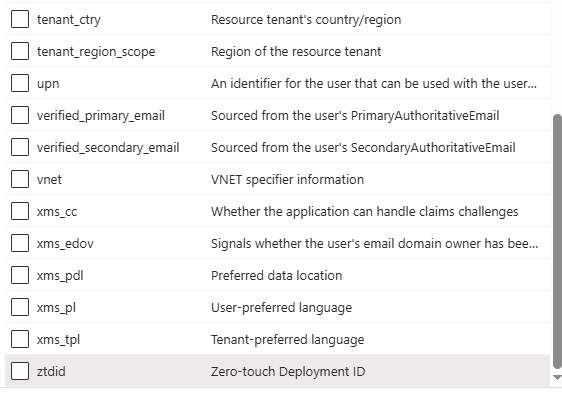
*Entra's optional-claims list has no Employee ID, which is why a claims mapping policy is needed.*

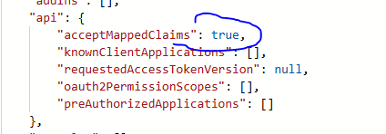
*App manifest: acceptMappedClaims set to true.*

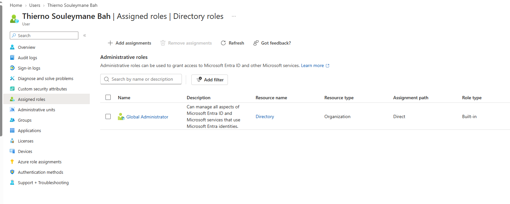
*The admin account used for the PowerShell steps holds Global Administrator.*


*Graph session with Policy.ReadWrite.ApplicationConfiguration, Policy.Read.All and Application.ReadWrite.All.*

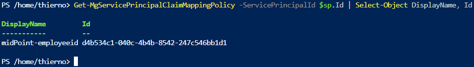
*The midPoint-employeeid claims mapping policy assigned to the app's service principal.*

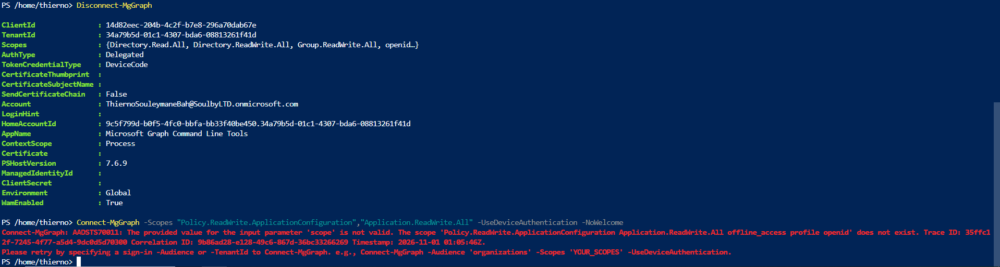
*Error seen when connecting without -TenantId (see troubleshooting).*

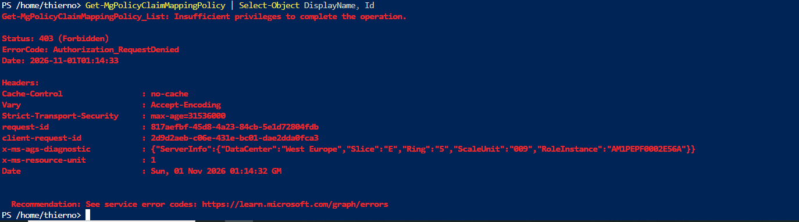
*Error seen when listing policies without Policy.Read.All (see troubleshooting).*

---

## 4. Docker: Java network and trust store fixes

Two Java-specific problems blocked the token exchange even though `curl` inside the container worked (curl uses the OS network stack and certificates, Java uses its own). Both are fixed with `_JAVA_OPTIONS` on the midPoint service in `docker-compose.yml`:

```yaml
  midpoint:
    image: evolveum/midpoint:latest
    environment:
      # ... existing MP_SET_* variables ...
      # Must stay on ONE line:
      _JAVA_OPTIONS: "-Djava.net.preferIPv4Stack=true -Djavax.net.ssl.trustStore=/etc/ssl/certs/java/cacerts -Djavax.net.ssl.trustStorePassword=changeit"
```

| Option | Why |
|---|---|
| `-Djava.net.preferIPv4Stack=true` | The container has no IPv6 route. Java tried IPv6 first and failed with `SocketException: Network is unreachable` when calling the token endpoint. |
| `-Djavax.net.ssl.trustStore=...` | Java reported `InvalidAlgorithmParameterException: the trustAnchors parameter must be non-empty` on every HTTPS call to Entra. Pointing Java explicitly at the full system CA bundle resolved it. |

> **Honest caveat.** `keytool -list -cacerts` showed 121 certificates and the file was healthy (~137 KB), yet Java still saw an empty trust anchor set. The root cause was not fully diagnosed. The explicit `trustStore` option fixed it. The path is specific to this image, so check it exists if you change images.

Apply with:

```bash
docker compose up -d midpoint
docker logs <midpoint-container> 2>&1 | grep -i "_JAVA_OPTIONS"   # confirm "Picked up _JAVA_OPTIONS"
```

All data lives in named volumes (`postgres_data`, `midpoint_home`), so recreating the midPoint container keeps the configuration. Never run `docker compose down -v` unless you want a full reset.


### Screenshots

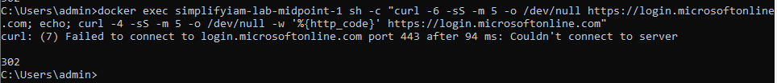
*curl -6 fails to connect while curl -4 succeeds: the container has no IPv6 route.*

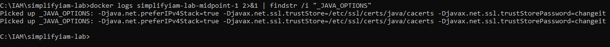
*The midPoint container log confirms the IPv4 and trust store options were picked up.*

---

## 5. midPoint: OIDC module and sequence

Edit **Repository objects → Security policy → Default Security Policy → Edit raw**. Add the module under `<modules>` and a new sequence next to the existing ones. **Keep the existing `loginForm`, `httpBasic` modules and the three default sequences untouched.** They are your break-glass login.

```xml
<!-- inside <authentication><modules> -->
<oidc>
  <identifier>entra-oidc</identifier>
  <client>
    <registrationId>entra</registrationId>
    <clientId>YOUR-CLIENT-ID</clientId>
    <clientSecret>
      <t:clearValue>YOUR-CLIENT-SECRET-VALUE</t:clearValue>
    </clientSecret>
    <clientAuthenticationMethod>clientSecretBasic</clientAuthenticationMethod>
    <nameOfUsernameAttribute>employeeid</nameOfUsernameAttribute>
    <scope>profile</scope>
    <scope>email</scope>
    <openIdProvider>
      <issuerUri>https://login.microsoftonline.com/YOUR-TENANT-ID/v2.0</issuerUri>
      <authorizationUri>https://login.microsoftonline.com/YOUR-TENANT-ID/oauth2/v2.0/authorize</authorizationUri>
      <tokenUri>https://login.microsoftonline.com/YOUR-TENANT-ID/oauth2/v2.0/token</tokenUri>
      <userInfoUri>https://graph.microsoft.com/oidc/userinfo</userInfoUri>
      <jwkSetUri>https://login.microsoftonline.com/YOUR-TENANT-ID/discovery/v2.0/keys</jwkSetUri>
    </openIdProvider>
  </client>
</oidc>

<!-- inside <authentication>, next to the existing <sequence> elements -->
<sequence>
  <identifier>entra-sso</identifier>
  <displayName>Entra ID SSO</displayName>
  <channel>
    <channelId>http://midpoint.evolveum.com/xml/ns/public/common/channels-3#user</channelId>
    <default>false</default>
    <urlSuffix>entra</urlSuffix>
  </channel>
  <module>
    <identifier>entra-oidc</identifier>
    <order>10</order>
    <necessity>sufficient</necessity>
  </module>
</sequence>
```

Points that mattered:

- **`clientAuthenticationMethod`** accepts `clientSecretBasic`, `clientSecretPost`, `clientSecretJwt`, `privateKeyJwt`. The OAuth spelling `client_secret_basic` is not the midPoint value.
- **`issuerUri`** belongs inside `openIdProvider`, not directly under `client`.
- **Scopes:** midPoint adds `openid` itself, so list only `profile` and `email`.
- **Explicit endpoint URLs.** With only `issuerUri`, the module failed to load (`web.security.flexAuth.wrong.auth.modules.config`, causing a browser redirect loop). Adding the endpoints explicitly got the module loading. This was done before the Java fixes in section 4, so it is untested whether discovery alone would now work.
- **Secret storage.** midPoint encrypts `clearValue` on save and shows an encrypted block when you reopen the object. If you re-save the same secret, the ciphertext may be unchanged.
- **`<default>false</default>`** keeps the normal login page as the default. SSO is reached at `/midpoint/auth/entra`.


### Screenshots

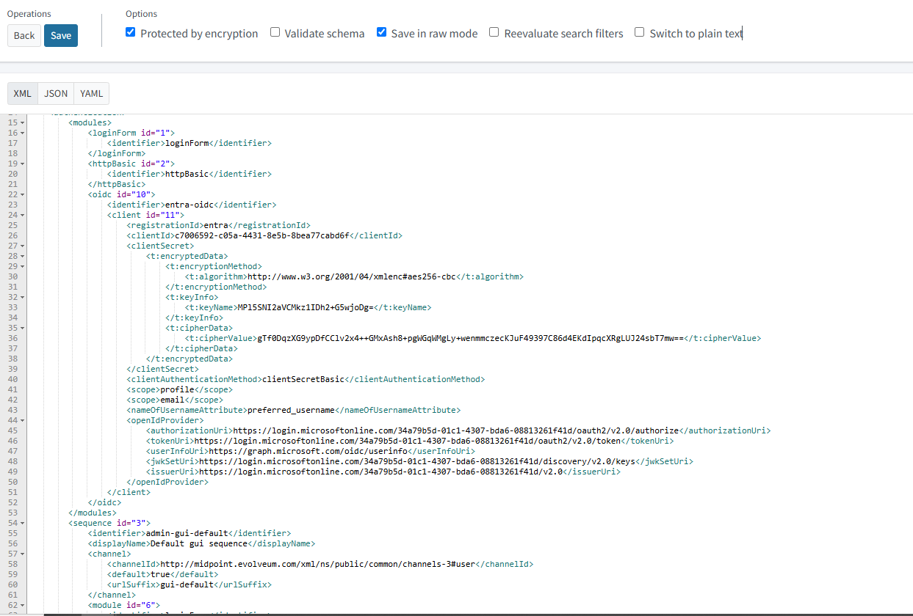
*Default Security Policy in Edit raw: OIDC module with explicit endpoints (the secret is stored encrypted).*

---

## 6. Matching Entra users to HR identities

midPoint takes the value of the claim named in `nameOfUsernameAttribute` and looks for a user whose **name** equals it (the claim is read from the ID token, then the access token, then the user info endpoint). Matching on email or employee number attributes is not supported by this module.

In this lab, HR-driven users are named by employee ID (`1001`, `1002`, ...) while Entra UPNs look like `james.anderson@<tenant>.onmicrosoft.com`. These do not match, so there were two approaches:

| Approach | Result |
|---|---|
| `preferred_username` (the UPN) with a temporary midPoint user named after the UPN | Works. Good for proving the OIDC flow, but creates a duplicate identity. Used first as a test. |
| Custom `employeeid` claim from Entra, matched to the HR user name | **Final approach.** Signs in as the real identity. |

Per-user requirements for the final approach:

1. **Entra:** *Users → user → Properties → Job information → Employee ID* equals the midPoint name.
2. **midPoint:** the user holds a role that permits GUI access (here **End user**). Without it, authentication succeeds and midPoint then denies access.

### Temporary test user (optional, delete afterwards)

Used before the claim existed:

- Name: the exact UPN, description `TEMP - Entra SSO test, delete after`.
- Roles: **End user**.
- Give it a family name. This lab's object template creates an OpenLDAP account for every new user, and `inetOrgPerson` requires `sn`, otherwise provisioning fails with `objectClassViolation ... requires attribute 'sn'`.


### Screenshots

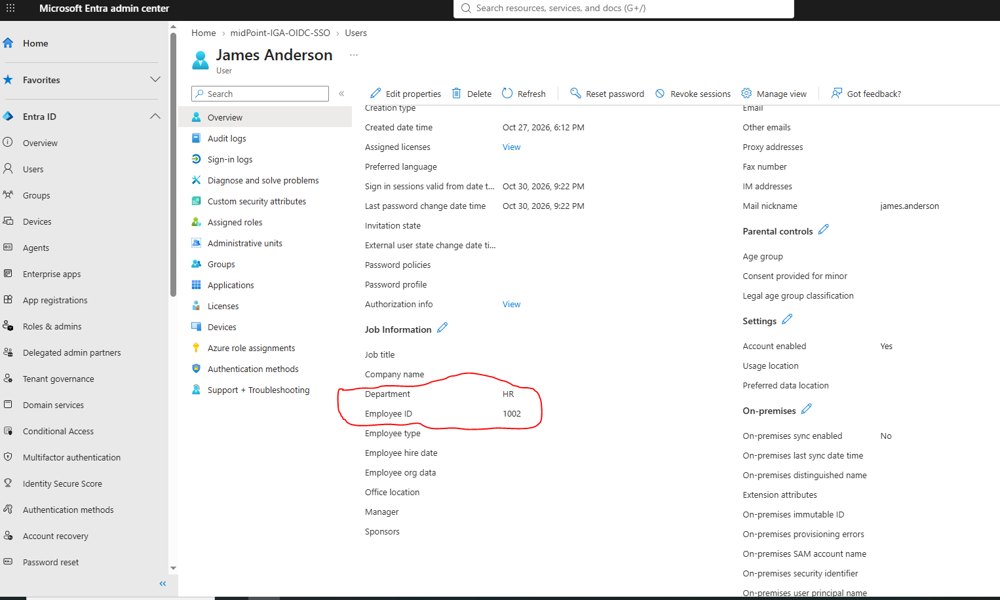
*Entra user properties: Employee ID is 1002.*

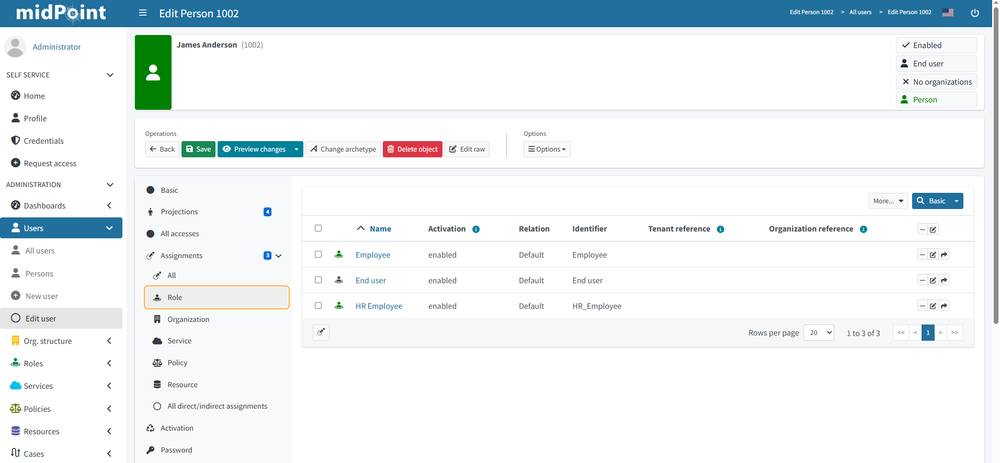
*midPoint user 1002 with Employee, End user and HR Employee assigned.*

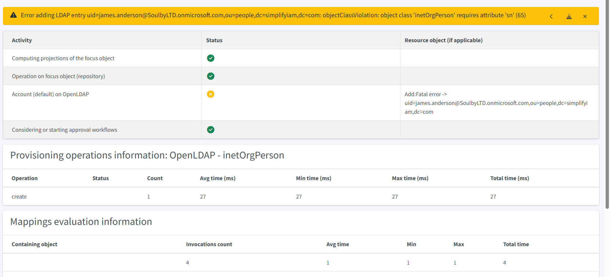
*Creating a user without a family name fails LDAP provisioning (objectClassViolation, sn).*

---

## 7. Testing

1. Confirm local login still works at `http://localhost:8080/midpoint` as `administrator`.
2. Open a **fresh private window** (or clear cookies for `localhost`). Stale `;jsessionid` URLs and old sessions cause an HTTP 400 or a redirect loop.
3. Go to `http://localhost:8080/midpoint/auth/entra`.
4. Sign in with the Entra account. Accept the consent prompt on first use.
5. Expect to land on the midPoint home page as the HR identity (for example `1002`).


### Screenshots

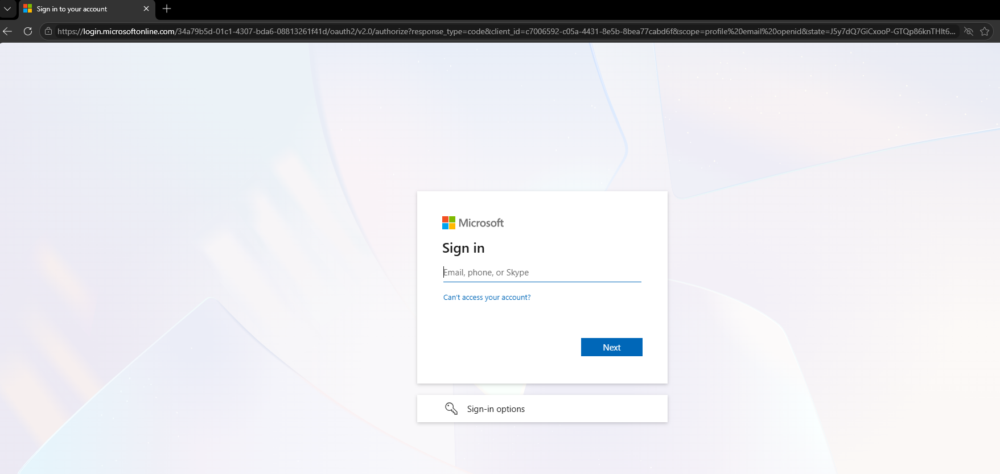
*Redirect from midPoint to Microsoft sign-in.*

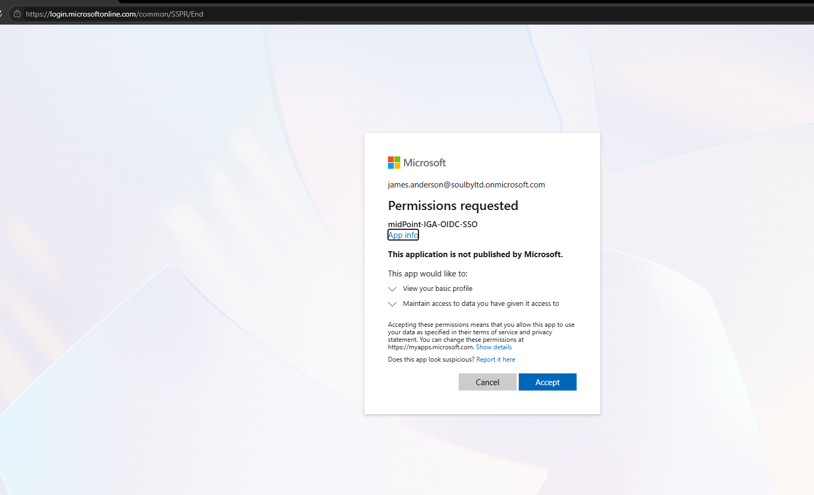
*First-time consent prompt for the app.*

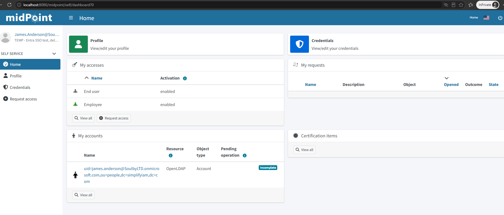
*First successful SSO login, as the temporary UPN-named user.*

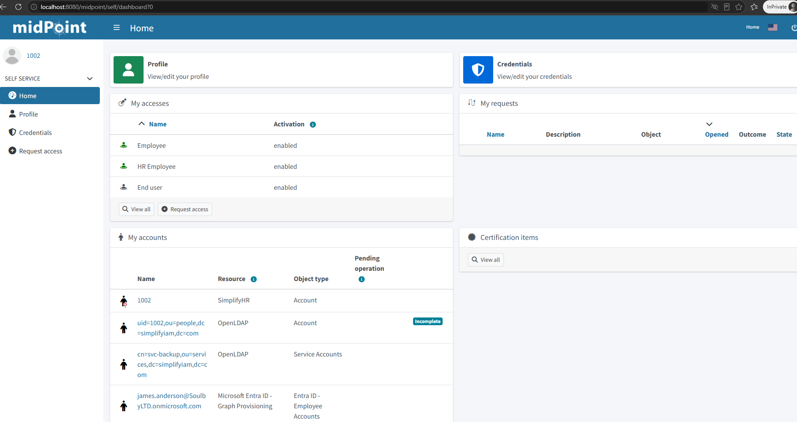
*Final result: signed in as the HR-driven identity 1002 using the employeeid claim.*

---

## 8. Troubleshooting log

Every error hit during this lab, in the order it appeared.

| Symptom | Cause | Fix |
|---|---|---|
| `ERR_TOO_MANY_REDIRECTS` on `/midpoint/auth/entra`; log shows `web.security.flexAuth.wrong.auth.modules.config` | OIDC module could not be built. | Add explicit `authorizationUri`, `tokenUri`, `userInfoUri`, `jwkSetUri` to `openIdProvider` (section 5), and fix the Java issues (section 4). |
| Stack trace in `ClientRegistration$Builder.validateAuthorizationCodeGrantType` | Incomplete client registration (endpoints could not be resolved). | As above. |
| HTTP 400 on `/midpoint/login;jsessionid=...` | Stale session and URL containing a semicolon. | Fresh private window; type the URL by hand. |
| `curl` returns 400 when testing the tenant | Placeholder text (`TENANT-ID`) left in the command. | Use the real tenant ID. |
| Token endpoint test returns 401 | Wrong client ID (the Object ID instead of the Application ID). | Use the **Application (client) ID**. |
| Generic red "unable to process your request"; audit log shows `web.security.provider.unavailable` | Technical failure during the token exchange. | Enable DEBUG logging (see below), read the real cause. |
| `Network is unreachable` on POST to the token endpoint | Java preferred IPv6; container has no IPv6 route. | `-Djava.net.preferIPv4Stack=true`. |
| `the trustAnchors parameter must be non-empty` | Java saw no trusted CAs. | `-Djavax.net.ssl.trustStore=/etc/ssl/certs/java/cacerts` plus password (section 4). |
| Entra: "Your account or password is incorrect" | Lab user's password unknown. | Reset the password in Entra. |
| `AADSTS70011 ... scope does not exist` in Cloud Shell | Device-code sign-in resolved against the wrong authority. | Add `-TenantId <tenant-id>` to `Connect-MgGraph`. |
| `Get-MgPolicyClaimMappingPolicy` returns 403 even for a Global Administrator | Session lacked `Policy.Read.All`. | Reconnect with `Policy.Read.All` added to the scopes. |
| Policy "created" but `$p.Id` is empty | Output simply not shown. | List policies, then assign the existing one. |
| LDAP error `requires attribute 'sn'` on saving the test user | New users get an OpenLDAP account automatically. | Set a family name. |

### Enabling DEBUG logging (remove afterwards)

*Configuration → System → Logging → Class loggers:* add `com.evolveum.midpoint.authentication` and `org.springframework.security` at **DEBUG**. Then:

```bash
docker logs --since 5m <midpoint-container> > oidc.txt 2>&1
# Windows: findstr /i /c:"oauth2" /c:"invalid" /c:"token" /c:"Caused by" oidc.txt
```

The default log level hides the real cause behind a generic message. The **Audit log viewer** (*Reports → Audit log viewer*) shows failed `CREATE_SESSION` events with a short message.


### Screenshots

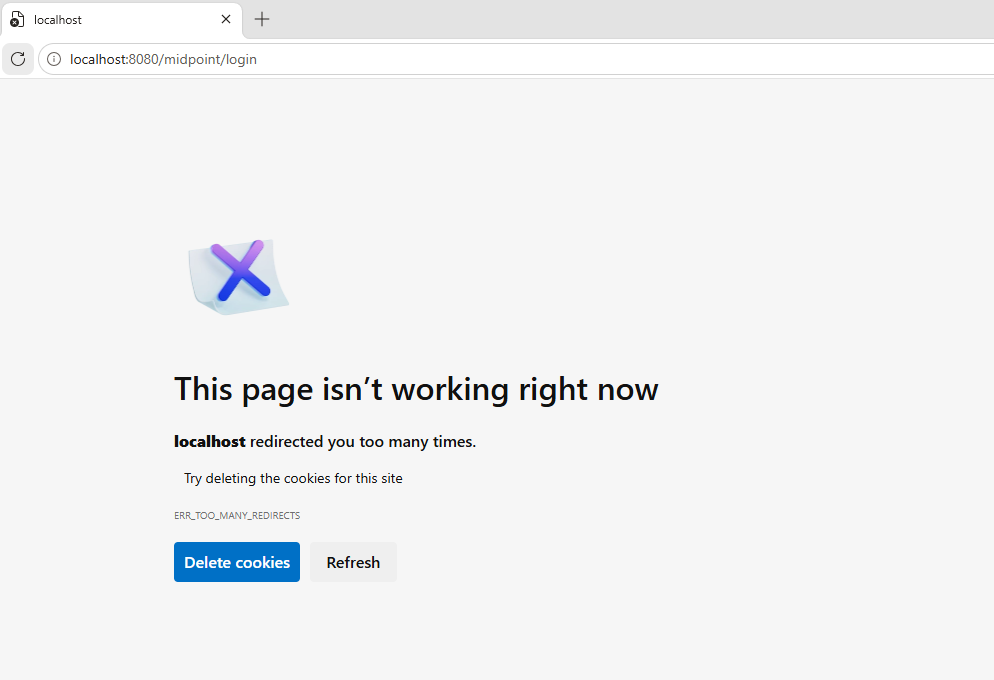
*Browser loop caused by the OIDC module failing to initialise.*

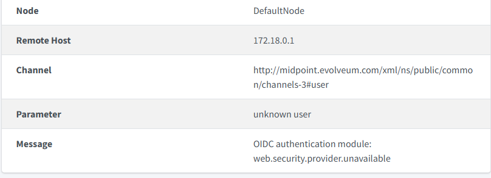
*Audit log event: OIDC authentication module, web.security.provider.unavailable.*

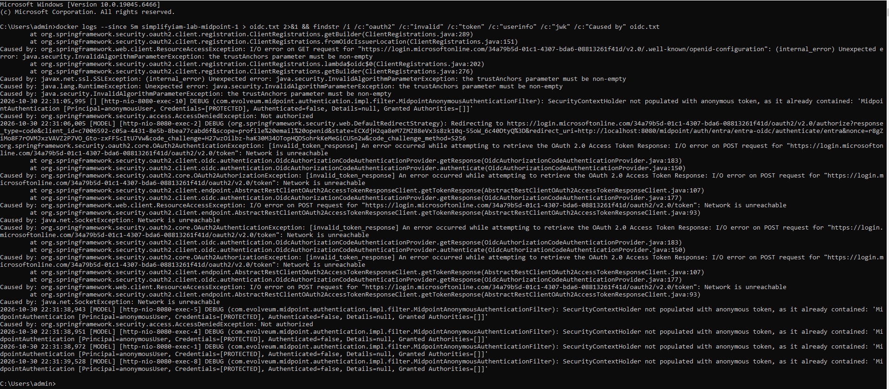
*DEBUG log showing the token endpoint call failing with Network is unreachable and the trustAnchors error.*

---

## 9. Cleanup and hardening

- [ ] Delete any temporary test user (midPoint also removes its LDAP account).
- [ ] Remove the two DEBUG class loggers.
- [ ] **Rotate the client secret** if it was ever pasted into a screenshot, chat or log: create a new secret in Entra, update `clearValue` in the policy, test, then delete the old secret in Entra.
- [ ] Keep `admin-gui-default` as the default sequence so the local login remains a break-glass path.
- [ ] Set a calendar reminder for client secret expiry. When it expires, SSO stops, but local admin login still works.
- [ ] Do not commit `docker-compose.yml` comments or `.env` files that contain lab credentials to a public repository.
- [ ] Review who holds **Global Administrator**. It was used here to create the claims mapping policy and can be reduced afterwards.

---

## 10. Rollback

SSO is additive, so rolling back is safe:

1. In the Default Security Policy set `nameOfUsernameAttribute` back to `preferred_username` (the UPN-named temporary user then works again), or remove the `entra-oidc` module and `entra-sso` sequence entirely.
2. Optionally remove the claims policy:

   ```powershell
   Remove-MgServicePrincipalClaimMappingPolicyByRef -ServicePrincipalId $sp.Id -ClaimsMappingPolicyId $p.Id
   Remove-MgPolicyClaimMappingPolicy -ClaimsMappingPolicyId $p.Id
   ```

3. The local `administrator` login through the normal form is never affected.

---

## Screenshot redaction checklist

Blur or crop these before publishing the repository. Do this on the final images, and check the image history too if you ever committed an unredacted version.

| Image | Blur |
|---|---|
| `01-entra-add-redirect-uri.png` | Tenant or user names in the header |
| `03-entra-manifest-acceptmappedclaims.png` | Nothing sensitive expected |
| `04-entra-global-administrator-role.png` | Admin user name |
| `05-graph-scopes-connected.png` | Nothing sensitive expected |
| `06-claims-policy-assigned.png` | Policy ID (optional) |
| `09-midpoint-security-policy-edit-raw.png` | Client ID, tenant ID in the URLs, encrypted secret and key name |
| `10-entra-employee-id.png` | Names, email, creation dates, tenant details |
| `11-midpoint-user-1002-roles.png` | Nothing sensitive expected |
| `12-ldap-sn-error-new-user.png` | Tenant domain in the user name |
| `13-microsoft-sign-in.png` | Tenant ID, client ID, `state`, `nonce` in the address bar |
| `14-entra-consent-prompt.png` | User email |
| `15-sso-success-temp-user.png` | User name containing the tenant domain |
| `16-sso-success-user-1002.png` | Tenant domain in the Entra account name |
| `17-audit-log-provider-unavailable.png` | Session and event identifiers |
| `19-graph-aadsts70011-scope-error.png` | Tenant ID, trace and correlation IDs, admin account name |
| `20-graph-403-forbidden.png` | Request IDs |
| `21-debug-log-network-unreachable.png` | Tenant ID, client ID, `state` and `nonce` values |

Screenshots of `curl` token tests are deliberately **not** included, because they contained a client secret in plain text.

---

## References

- midPoint documentation: *OIDC authentication module* (flexible authentication)
- Microsoft Learn: *Customize claims emitted in tokens for a specific app (claims mapping policy)*
